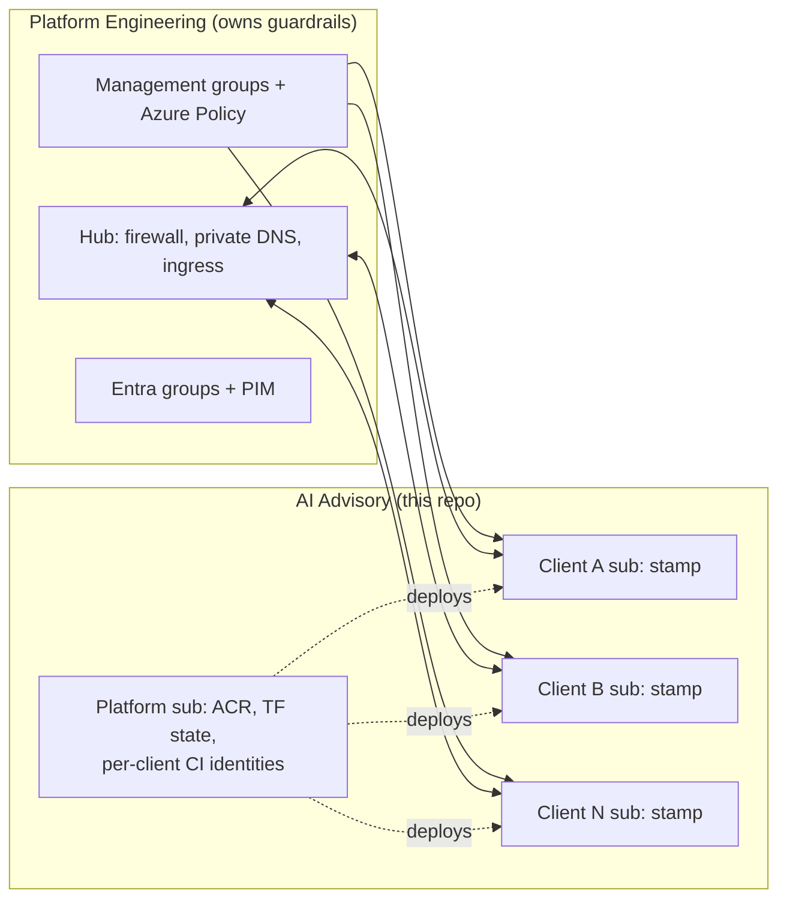

# AI Advisory hosting platform on Azure

A reference design and runnable Terraform for hosting AI solutions **once** and serving them to
**many clients**, with each client's data isolated in its own Azure subscription. Built to run
inside a central Platform Engineering team's landing zone (policies, Entra groups, hub
networking), not around it.



## What a client gets (the "stamp")
Spoke VNet peered to the hub, everything private: Azure OpenAI (data-zone deployments, keys off),
AI Search, Storage, Key Vault, internal Container Apps, a user-assigned managed identity with
resource-scoped roles, its own Log Analytics + App Insights, budget alerts, and delete locks.

## Repo layout
| Path | What |
|---|---|
| `docs/adr/` | Architecture decisions and trade-offs ([index](docs/adr/README.md)) |
| `docs/architecture/` | Diagrams: estate, stamp, request path ([overview](docs/architecture/overview.md)) |
| `docs/runbooks/` | Onboard / offboard a client, incident runbook |
| `docs/interview/` | Topic map, likely questions, 30/60/90, AI tooling notes |
| `terraform/modules/` | Reusable modules: naming, spoke-network, private-endpoint, key-vault, storage, ai-services, container-apps, observability, workload-identity, deployment-identity |
| `terraform/stamps/client/` | Root module: one complete isolated client environment, plus offline tests |
| `terraform/platform/` | Shared platform subscription: state, ACR, per-client CI identities |
| `terraform/clients/<code>/` | Per-client `terraform.tfvars`, `backend.hcl`, `client.json` (ring) |
| `policy/` | AI guardrail policy definitions proposed to Platform Engineering |
| `.github/workflows/` | PR checks + per-client plans, ring-based apply, nightly drift |

## Try it
Offline (no Azure account needed):
```bash
cd terraform/stamps/client
terraform init -backend=false
terraform validate
terraform test          # mocked provider; asserts isolation/security properties
```

Deploy a demo client into your own subscription (standalone mode, no hub required):
```bash
az login
cd terraform/stamps/client
terraform init -backend=false           # or -backend-config=../../clients/<code>/backend.hcl
terraform apply \
  -var-file=../../clients/chatham/terraform.tfvars \
  -var="subscription_id=$(az account show --query id -o tsv)" \
  -var="enable_locks=false"
```
You need Azure OpenAI quota for the model in `clients/chatham/terraform.tfvars` in your region.
Tear down with `terraform destroy` using the same arguments. Key Vault and the AOAI account are
soft-deleted afterwards (purge protection on Key Vault is intentional).

### Platform bootstrap (once)
1. `cd terraform/platform`, copy `terraform.tfvars.example` to `terraform.tfvars`.
2. Comment out the `backend "azurerm" {}` block, `terraform apply` with local state.
3. Restore the block, `terraform init -migrate-state -backend-config=...` into the
   `tfstate-platform` container.
4. Copy `deployment_client_ids` / `plan_client_ids` outputs into the GitHub Environments
   `client-<code>` / `client-<code>-plan` as `AZURE_CLIENT_ID` (plus `AZURE_TENANT_ID`).

## CI
Pull requests run `fmt`, `validate`, offline `terraform test`, tflint and checkov with no Azure
access. Per-client plan, ring deploy and drift jobs stay off until the repository variable
`AZURE_ENABLED` is set to `true` and the GitHub Environments described above exist.

## Status and known gaps
- Validated with Terraform 1.9.8 and azurerm 4.81; all offline tests pass. Not yet applied to a
  live subscription. The client configs use placeholder subscription and object IDs.
- Known gaps, not built yet: self-hosted runners for private data-plane access, Azure
  Monitor Private Link Scope, customer-managed keys per client, and the front-door/ingress pattern
  (owned by Platform Engineering).
