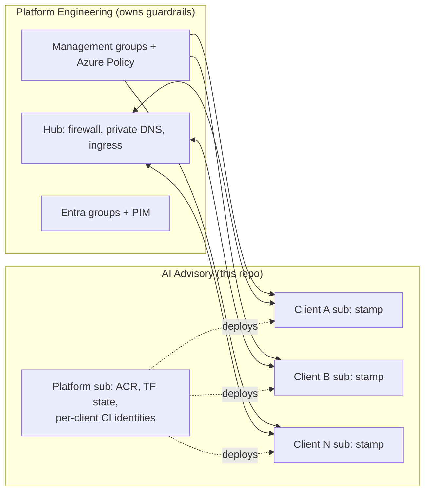
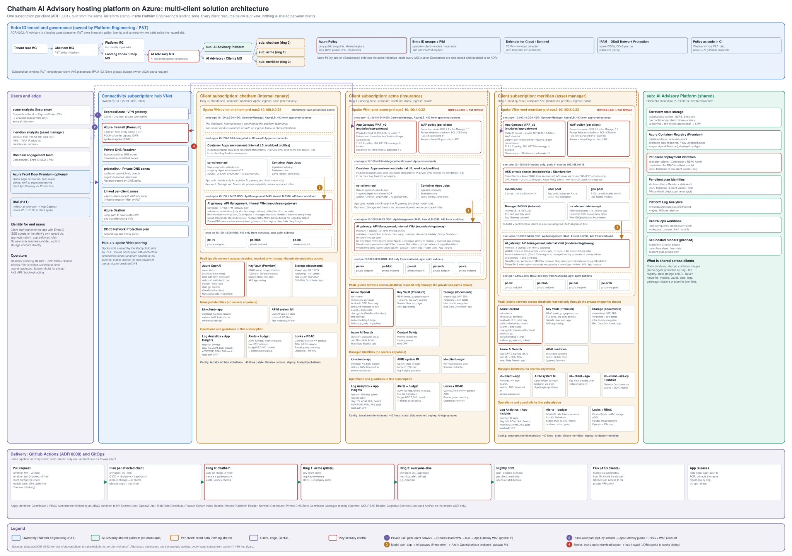

# AI Advisory hosting platform on Azure

A reference design and runnable Terraform for hosting AI solutions **once** and serving them to
**many clients**, with each client's data isolated in its own Azure subscription. Built to run
inside a central Platform Engineering team's landing zone (policies, Entra groups, hub
networking), not around it.

**Three isolation tiers** ([ADR 0014](docs/adr/0014-isolation-tiers.md), proposed;
[design, diagrams and cost math](docs/architecture/isolation-tiers.md)):

| Tier | What's shared | What's per client | Fixed cost (approx. USD/month) | Terraform |
|---|---|---|---|---|
| 1. Dedicated (default) | Only P&T's hub | Everything, in its own subscription | ~1,500 per client | `stamps/client` |
| 2. Shared cell | Front door, compute, AI gateway, search service | Data, keys, model account, logs, identities, in its own resource group | ~170 per client | `stamps/cell` + `stamps/cell-client` |
| 3. Pooled (internal/public data) | One app and model account | Container, index, encryption scope, group, ingestion identity; the app reads with the user's token | ~45 per tenant | `stamps/pool` |

**All three tier diagrams side by side:** [docs/architecture/tiers-side-by-side.md](docs/architecture/tiers-side-by-side.md),
with each tier's cost, isolation boundary and trade-off under its diagram, plus
[one wide image](docs/architecture/diagram/tiers-side-by-side.png) for screen sharing.



**Full picture:** [docs/architecture/diagram/solution-architecture.svg](docs/architecture/diagram/solution-architecture.svg) shows every component for three example clients side by side (governance, hub, each client stamp, the shared platform subscription and the delivery pipeline). It is generated from [generate.py](docs/architecture/diagram/generate.py).

**Edit it in draw.io:** [open in diagrams.net](https://app.diagrams.net/#Uhttps%3A%2F%2Fraw.githubusercontent.com%2Fcoppercosmo%2Fchatham_fin_infra%2Fmain%2Fdocs%2Farchitecture%2Fdiagram%2Fsolution-architecture.drawio) (editable copy; use File > Save as to keep your changes), or [open from GitHub](https://app.diagrams.net/#Hcoppercosmo%2Fchatham_fin_infra%2Fmain%2Fdocs%2Farchitecture%2Fdiagram%2Fsolution-architecture.drawio) to save edits back to the repo. The native file is [solution-architecture.drawio](docs/architecture/diagram/solution-architecture.drawio), with Azure icons and every box as its own shape.

[](docs/architecture/diagram/solution-architecture.svg)

**The AI layer:** [docs/architecture/diagram/ai-request-flow.svg](docs/architecture/diagram/ai-request-flow.svg) follows one
question from the analyst to a cited answer (embed, search the client's own index, generate through the AI
gateway) and shows how the index is filled ahead of time. Explained in plain words, with isolation per tier,
capacity, evaluations and content safety, in
[docs/interview/deep-dives/ai-architecture.md](docs/interview/deep-dives/ai-architecture.md). Every tier fills
its indexes with the same ingestion job, running as each client's own identity, and every model deployment
has a content filter that blocks instructions hidden in documents
([ADR 0015](docs/adr/0015-document-ingestion.md)).

## What a client gets (the "stamp")
Spoke VNet peered to the hub, everything private: Azure OpenAI (data-zone deployments, keys off),
AI Search, Storage, Key Vault, a user-assigned managed identity with resource-scoped roles, its own
Log Analytics + App Insights, budget alerts, and delete locks. Two per-client choices:

- **Compute**: internal Container Apps (default) or a dedicated private AKS cluster
  (`compute_platform = "aks"`, ADR 0011).
- **Ingress**: an Application Gateway WAF_v2 with a private frontend (or a locked-down public one),
  TLS end to end with certificates from the client's Key Vault (`ingress = {...}`, ADR 0010).
- **AI gateway**: an internal API Management AI gateway between the app and its models, with
  per-caller token limits, token metering, backend failover and optional Prompt Shields
  (`ai_gateway = {...}`, ADR 0012).
- **Client network**: how the client's own network reaches its App Gateway privately
  (`client_connectivity`, ADR 0013): `privatelink` from the client's own Azure (preferred, no
  routing), `expressroute` or `vpn` through Platform Engineering's hub with a firewall rule, NSG and
  WAF allow-list per client, or `none`. Explained in plain words, with a networking glossary, in
  [docs/architecture/client-connectivity.md](docs/architecture/client-connectivity.md).

## Repo layout
| Path | What |
|---|---|
| `docs/adr/` | Architecture decisions and trade-offs ([index](docs/adr/README.md)) |
| `docs/architecture/` | Diagrams: estate, stamp, request path ([overview](docs/architecture/overview.md)); [the three tier diagrams side by side](docs/architecture/tiers-side-by-side.md); [client network connectivity](docs/architecture/client-connectivity.md); full multi-client, tier and AI request-flow diagrams in `diagram/` |
| `docs/runbooks/` | Onboard / offboard a client, connect a client's network, incident runbooks |
| `docs/interview/` | [Study guide](docs/interview/README.md): topic map, deep dives (including [the AI layer end to end](docs/interview/deep-dives/ai-architecture.md)), mock technical test, repo walkthrough, likely questions, 30/60/90 |
| `terraform/modules/` | Reusable modules: naming, spoke-network, private-endpoint, key-vault, storage, ai-services, ai-gateway, container-apps, ingestion-job, aks, app-gateway, shared-app-gateway, observability, workload-identity, deployment-identity, cidr-overlap, policy-guardrails, and hub-connectivity (the last two proposed to Platform Engineering) |
| `terraform/stamps/client/` | Tier 1 root module: one complete isolated client environment, plus offline tests |
| `terraform/stamps/cell/`, `terraform/stamps/cell-client/` | Tier 2: the shared cell (per-client resource groups, sites, apps, gateway APIs) and each client's data in its own resource group |
| `terraform/stamps/pool/` | Tier 3: the pooled app with per-tenant containers, indexes, identities and jobs |
| `terraform/platform/` | Shared platform subscription: state, ACR, per-client CI identities |
| `terraform/hub/` | Reference connectivity hub (Platform Engineering owns the real one): gateways, firewall, DNS resolver, wired to `hub-connectivity` |
| `terraform/clients/<code>/` | Per-client `terraform.tfvars`, `backend.hcl`, `client.json` (ring) |
| `terraform/cells/<cell>/`, `terraform/pools/<pool>/` | Example Tier 2 and Tier 3 configs (`cells/cell01/clients/<client>.tfvars` per cell client) |
| `terraform/exercises/` | Interview practice: a from-scratch VNet + private endpoints + private DNS, with tests |
| `kubernetes/` | AKS path: internal NGINX controller, app with workload identity, default-deny network policy |
| `policy/` | Guardrail policy definitions proposed to Platform Engineering, deployable as one initiative with `terraform/modules/policy-guardrails` |
| `.github/workflows/` | PR checks + per-client plans, ring-based apply, nightly drift |

## Try it
Offline (no Azure account needed):
```bash
cd terraform/stamps/client
terraform init -backend=false
terraform validate
terraform test          # mocked provider; asserts isolation/security properties
cd ../../..
scripts/test-client-configs.sh   # every stamp's tests, plus a type-check of every config in clients/, cells/ and pools/
cd terraform/hub && terraform init -backend=false && terraform test -var-file=terraform.tfvars.example
```

Deploy a demo client into your own subscription (standalone mode, no hub required):
```bash
az login
cd terraform/stamps/client
terraform init -backend=false           # or -backend-config=../../clients/<code>/backend.hcl
terraform apply \
  -var-file=../../clients/chatham/terraform.tfvars \
  -var="subscription_id=$(az account show --query id -o tsv)" \
  -var="enable_locks=false"
```
You need Azure OpenAI quota for the model in `clients/chatham/terraform.tfvars` in your region.
Tear down with `terraform destroy` using the same arguments. Key Vault and the AOAI account are
soft-deleted afterwards (purge protection on Key Vault is intentional).

### Platform bootstrap (once)
1. `cd terraform/platform`, copy `terraform.tfvars.example` to `terraform.tfvars`.
2. Comment out the `backend "azurerm" {}` block, `terraform apply` with local state.
3. Restore the block, `terraform init -migrate-state -backend-config=...` into the
   `tfstate-platform` container.
4. Copy `deployment_client_ids` / `plan_client_ids` outputs into the GitHub Environments
   `client-<code>` / `client-<code>-plan` as `AZURE_CLIENT_ID` (plus `AZURE_TENANT_ID`).

## CI
Pull requests run `fmt`, `validate`, offline `terraform test`, tflint and a blocking checkov scan with no Azure
access. Per-client plan, ring deploy and drift jobs stay off until the repository variable
`AZURE_ENABLED` is set to `true` and the GitHub Environments described above exist.

## Status and known gaps
- Validated with Terraform 1.9.8 and azurerm 4.81; all offline tests pass. Not yet applied to a
  live subscription. The client configs use placeholder subscription and object IDs.
- Tiers 2 and 3 (ADR 0014) are proposed: designed, built and tested offline, with open questions for
  P&T (two narrow custom roles per cell) and for Chatham's risk team (whether contracts accept a
  shared cell for confidential data). Their cost depends most on whether Standard v2 API Management
  works for the internal gateway; the Terraform uses Developer or Premium today.
- ADR 0009 describes metric alerts deployed by the stamp; the observability module doesn't create
  them yet. The design for them, and for using them to gate ring promotion, is in
  [docs/interview/deep-dives/observability-per-client.md](docs/interview/deep-dives/observability-per-client.md).
- Known gap found while building ADR 0013: Microsoft now requires subnet delegation to
  `Microsoft.Network/applicationGateways` for private-only App Gateway deployments, which
  `snet-agw` doesn't set yet for `frontend_mode = "private"` without Private Link.
- AI layer gaps (details in [the AI deep dive](docs/interview/deep-dives/ai-architecture.md#honest-gaps-in-this-repo-ai-layer)):
  the ingestion and index-admin jobs run an image from the application repo (placeholder digests here);
  index definitions are applied by a job, not Terraform; the shared tiers' `job-index-admin` is started by
  hand after onboarding; the evaluation pipeline is designed, not built.
- Known gaps, not built yet: self-hosted runners for private data-plane access, Azure
  Monitor Private Link Scope, customer-managed keys per client, a Front Door Premium edge for
  internet-facing multi-region clients, Flux configuration for the AKS path, and two AI gateway
  settings azurerm 4.81 doesn't expose yet (load-balanced backend pools, App Insights custom metrics).
