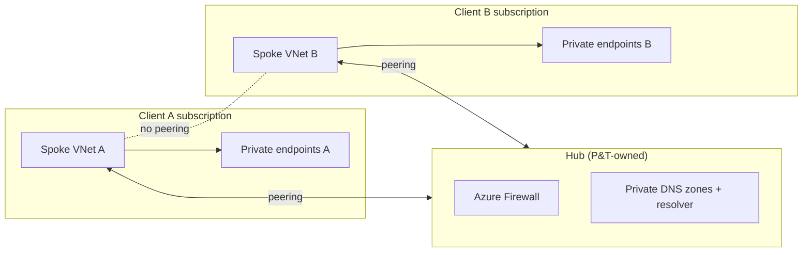

# ADR 0003: Private endpoints only, hub-and-spoke

- Status: Accepted
- Date: 2026-11-13

## Context
Client data flows through Azure OpenAI, AI Search, Storage, and Key Vault. All of these support
public endpoints by default. Financial-services clients will ask whether their data ever crosses
the public internet.

## Decision
- Each client subscription has one **spoke VNet** with an address space allocated from P&T's IPAM
  (a /22 per client by default). Subnets:
  - `snet-apps` (/24), delegated to `Microsoft.App/environments` for Container Apps
  - `snet-pe` (/26) for private endpoints
- **All PaaS services have `public_network_access` disabled** and are reached through private
  endpoints in `snet-pe`.
- Container Apps environment is **internal** (no public IP). Client users reach the app through
  P&T's ingress (Application Gateway / Front Door Premium with Private Link) or the client's
  private connectivity, decided per engagement.
- Egress: a route table sends `0.0.0.0/0` to the hub firewall, so outbound traffic is inspected
  and allow-listed.
- Spokes **never peer with each other**. The only path between two clients would be through the
  hub firewall, which denies spoke-to-spoke by default.
- Private DNS: in landing-zone mode the central `privatelink.*` zones live in the hub and records
  are created by P&T's "deploy-if-not-exists" policy. In standalone mode the stamp creates zones.

## Consequences
- CI/CD can't reach data-plane endpoints from GitHub-hosted runners. Terraform therefore only uses
  control-plane operations in the stamp (e.g., storage containers created via the ARM API), and any
  data-plane work (index creation, seeding) runs from **self-hosted runners in the platform
  subscription's VNet** or from the app at start-up.
- Private endpoints cost roughly USD 7-8/month each plus data processing. Accepted.
- Troubleshooting needs a jump path (Bastion in the hub, owned by P&T).
