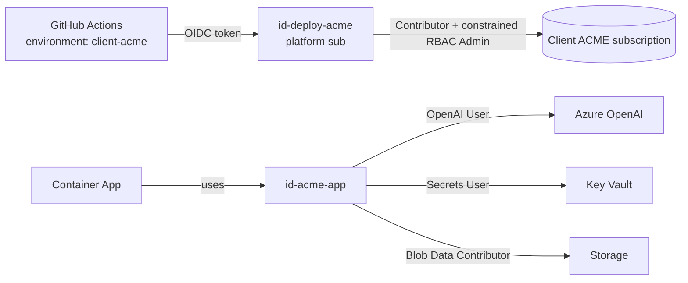

# ADR 0004: Managed identity everywhere, no keys

- Status: Accepted
- Date: 2026-11-13

## Decision
1. **Workloads** use a **user-assigned managed identity** per client app (`id-<client>-app`). It is
   granted only data-plane roles, scoped to the specific resource:
   - `Cognitive Services OpenAI User` on the client's Azure OpenAI account
   - `Key Vault Secrets User` on the client's Key Vault
   - `Storage Blob Data Contributor` on the client's storage account
   - `Search Index Data Reader` on the client's AI Search (if enabled)
   - `AcrPull` on the shared registry
2. **Local auth is disabled**: Azure OpenAI and AI Search `local_auth` off, Storage shared keys
   off, App Insights local auth off. There are no API keys to leak or rotate.
3. **Key Vault** uses Azure RBAC (not access policies), purge protection on. It exists for
   genuinely external secrets (e.g., a client's third-party API key), not for Azure-to-Azure auth.
4. **Humans**: P&T-owned Entra groups per client, passed in as object IDs:
   - `readers` group: `Reader` on the client resource group (standing access)
   - `operators` group: eligible via PIM for `Contributor`, time-bound, approval required.
   Nobody gets standing write access to production client data.
5. **Pipelines**: GitHub Actions authenticates with **OIDC workload identity federation**. Each
   client has its **own deployment identity**, federated only to the GitHub Environment for that
   client. A compromised pipeline run for client A cannot touch client B.
6. Pull requests and drift checks use a separate **read-only plan identity** per client
   (`Reader` + state read), federated to `client-<name>-plan`. Unreviewed code can never apply.
7. Deployment identities hold `Contributor` plus `Role Based Access Control Administrator`
   **with a condition** that limits which roles they may assign (the list above). This stops a
   pipeline from granting itself `Owner`.

## Consequences
- Apps must use `DefaultAzureCredential` / `ManagedIdentityCredential` with the `AZURE_CLIENT_ID`
  of the user-assigned identity. The stamp injects it as an environment variable.
- Some SDK features that assume keys need extra care; we treat that as the app team's fix, not a
  reason to re-enable keys.
