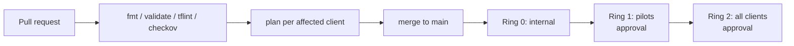

# ADR 0008: Ring-based CI/CD fan-out with OIDC and per-client identities

- Status: Accepted
- Date: 2026-11-13

## Decision
GitHub Actions (Azure DevOps works the same way; the decision is about the shape, not the tool).

1. **Pull request**: `terraform fmt`, `validate`, `tflint`, `checkov` (policy as code), then a
   `plan` for every client affected by the change (a change to a module affects every client; a
   change in `clients/acme` affects only acme). Plans are posted as PR summaries.
2. **Merge to main**: apply in **rings**, read from each client's `client.json`:
   - Ring 0: `chatham-internal` sandbox client (our own canary)
   - Ring 1: pilot clients who agreed to early updates
   - Ring 2: everyone else
   Each ring is a GitHub Environment; ring 1 and 2 require approval. A failed ring stops the rollout.
3. **Auth**: each matrix job runs in the GitHub Environment `client-<name>`, which holds only that
   client's `AZURE_CLIENT_ID`. The federated credential subject is
   `repo:<org>/<repo>:environment:client-<name>`, so a job can only ever get a token for its own client.
4. **Drift**: a nightly scheduled `plan -detailed-exitcode` across all clients; non-zero exit opens
   an issue. Manual portal changes are found within 24h.
5. **App releases** are separate from infra: the app pipeline builds once, pushes an immutable
   image digest to ACR, and promotes the same digest ring by ring via the `app_image` variable.

