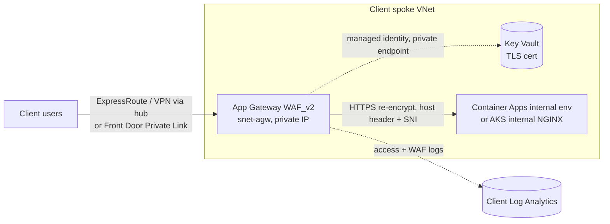

# ADR 0010: Private ingress through a per-client Application Gateway WAF_v2

- Status: Accepted
- Date: 2026-11-15

## Context
ADR 0003 makes every client service private, including compute. Users still need a way in:
the client's analysts (often over their own network to Chatham via ExpressRoute or VPN, sometimes
from the internet) and Chatham's own engagement team. That entry point is the single most attacked
part of the platform, it terminates TLS for the client's hostname, and it sees every prompt.

Requirements:
- No public endpoint by default; internet exposure is an explicit, per-client decision.
- A web application firewall in front of every client app, with rules that understand LLM traffic.
- TLS end to end (client -> gateway -> app), certificates in the client's Key Vault, no secrets in code.
- Logs of every request and every WAF decision land in **that client's** workspace (ADR 0009).
- Fits P&T's hub-and-spoke: their DNS, their firewall, their DDoS plan.

## Options considered

| Option | Isolation | Notes |
|---|---|---|
| **A. App Gateway WAF_v2 per client, in the client spoke** | Strong: own WAF policy, own certs, own logs, own scale | ~USD 330/month base + capacity units per client. Chosen. |
| B. One shared App Gateway in the hub (P&T-owned), a listener per client | Medium: per-listener WAF policies exist, but one config, one identity reading every client's certs, one blast radius, per-gateway listener and certificate limits | Cheaper. A bad config push takes every client down; certs for all clients sit behind one identity. |
| C. Azure Front Door Premium -> Private Link -> internal backend | Strong at the edge, global | Best for internet-facing, multi-region. Adds a global service and DNS cut-over; doesn't help private-only users on ExpressRoute. A complement, not a replacement (see below). |
| D. Application Gateway for Containers (AKS only) | Per cluster | Doesn't serve Container Apps; feature parity (private frontends, WAF) still maturing. Revisit for AKS-only estates. |
| E. Container Apps / AKS ingress directly | Weak | No WAF, TLS terminates in the workload tier. Rejected. |

## Decision
**Option A.** Each client stamp optionally gets an Application Gateway WAF_v2 in a dedicated
`snet-agw` subnet (/24) of its spoke (`terraform/modules/app-gateway`).

### Frontend
- `frontend_mode = "private"` (default): private frontend IP only (static, `x.x.2.10`). Uses App
  Gateway's network-isolation (private-only) deployment, so no public IP exists at all. P&T's DNS
  maps `<client>.ai.<domain>` to that IP; users arrive through the hub (ExpressRoute/VPN), or through
  Front Door Premium with Private Link if the client is internet-based but wants a global edge.
- `frontend_mode = "public"`: a zone-redundant Standard public IP is added and the listener moves to
  it. Exposure is limited twice: the subnet NSG allows 443 only from `allowed_source_prefixes` (the
  client's egress ranges, or the `AzureFrontDoor.Backend` tag), and a WAF custom rule blocks anything
  outside `allowed_client_cidrs`. DDoS Network Protection comes from P&T's policy on public IPs.

### TLS, end to end
- Listener certificate lives in **the client's** Key Vault. The gateway reads it with its own
  user-assigned identity (`Key Vault Secrets User` on that vault only), through the vault's private
  endpoint. The secret ID is **versionless**, so renewals are picked up automatically (App Gateway
  polls every 4 hours). No PFX files, no passwords in pipelines.
- TLS policy `AppGwSslPolicy20220101S`: TLS 1.2+ with strong ciphers. SNI required.
- Re-encryption to the backend over HTTPS:
  - **Container Apps**: backend is the environment's static internal IP, with the app's FQDN sent as
    host header and SNI. The backend cert is Microsoft-issued for the environment domain, so it
    validates without a custom root. Targeting the IP (not the FQDN) means App Gateway never needs to
    resolve the environment's private DNS zone through P&T's hub resolver, a common gotcha.
  - **AKS**: backend is the static internal load-balancer IP of the managed NGINX controller (ADR
    0011), with the client hostname as host header. NGINX serves the same certificate, pulled from the
    same Key Vault by the app routing add-on.

### WAF policy (one per client)
- Mode **Prevention**. A new client starts in Detection only in ring 0 while exclusions are tuned.
- Managed rules: **Microsoft_DefaultRuleSet 2.1** (OWASP CRS-based plus Microsoft threat intel,
  including Log4j) and **Bot Manager 1.1**.
- **LLM-aware exclusions.** Prompts are free text. "Select the top 10 rows from the claims table where
  status is open" looks like SQL injection; a user pasting HTML looks like XSS. Instead of turning
  rules off, the JSON fields that carry prompts (`messages`, `prompt`, `input`) are excluded **only
  from the SQLI and XSS rule groups**. Every other field is still inspected by those groups, and the
  prompt fields are still inspected by every other group (protocol, LFI/RFI, RCE, Java, bots...).
  Prompt-injection is an application-layer concern handled by Azure AI Content Safety / Prompt
  Shields in the app, not by the WAF.
- Request body inspection up to 2 MB (pasted documents), file uploads up to 100 MB.
- **Rate limit per client IP** (default 600/min) protects the client's Azure OpenAI quota and cost
  from a runaway script.
- Optional **IP allow-list** custom rule for public frontends.
- Per-listener or per-URI WAF policies are available if a client later hosts several apps with
  different needs (e.g., stricter `/admin`); the module keeps one policy per gateway for now.

### LLM-specific gateway settings
- **Response buffering off** so tokens stream to the user as they're generated (server-sent events).
  Request buffering stays on so the WAF sees the full body.
- **Backend timeout 180s** (default 20s cuts off long completions).
- Health probe on `/healthz`, via the same host header and TLS.

### Network
- Dedicated `snet-agw` subnet with an NSG: GatewayManager 65200-65535 and AzureLoadBalancer (needed
  by v2), 443 only from approved sources, deny everything else.
- The private-endpoint NSG allows 443 from `snet-agw` so the gateway can reach Key Vault.
- The hub-firewall route table is **not** applied to `snet-agw`: v2 needs a direct path for its
  management traffic unless the private-only deployment is used everywhere. P&T reviews this per their firewall standard.

## Consequences
- ~USD 330/month fixed per client plus capacity units; priced into the hosted engagement alongside
  the other per-client fixed costs (ADR 0001). Autoscale 1-5 by default.
- Certificates become an onboarding step: P&T or the client issues `<client>.ai.<domain>`, it's
  imported into the client vault (or issued by Key Vault's integrated CA), and the versionless ID goes
  in the client's tfvars.
- WAF tuning is ongoing operational work. See `docs/runbooks/waf-false-positive.md`.
- If P&T already runs a shared App Gateway or Front Door standard, we present this as the per-client
  pattern for regulated workloads and agree which clients (if any) may use the shared one.
