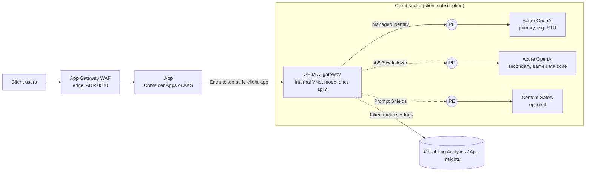

# ADR 0012: AI gateway (Azure API Management) between client apps and models

- Status: Accepted, pilot in ring 0 then ring 1 (see "Rollout")
- Date: 2026-11-15

## Context
Today each client app calls its own Azure OpenAI account directly with its managed identity
(ADR 0004, 0006). That's private and keyless, but it leaves gaps that matter once several hosted
solutions run per client:

- **Quota control**: one batch job can consume a deployment's whole TPM budget and throttle the
  client's interactive chatbot. The App Gateway per-IP rate limit (ADR 0010) is a blunt stand-in.
- **Chargeback**: Azure OpenAI metrics show tokens per deployment, not per calling app or use case.
- **Resilience**: a 429 from a saturated PTU deployment should spill to pay-as-you-go capacity, or
  another region in the same data zone, without every app re-implementing retry logic.
- **Consistent controls**: prompt screening (Prompt Shields), logging policy and model routing should
  be set once by the platform, not per app team.

Azure API Management's **AI gateway** capabilities target exactly this (`llm-token-limit`,
`llm-emit-token-metric`, backend circuit breakers and load-balanced pools, `llm-semantic-cache-*`,
`llm-content-safety`). Microsoft Foundry can also **attach an APIM AI gateway to a Foundry project**;
that integration is in **preview**. Some policies (`llm-content-safety`) are preview too, so status
is checked again at pilot time.

## Options

| Option | Isolation | Cost (approx. list price) | Notes |
|---|---|---|---|
| A. No gateway (status quo) | Strong | None | Gaps above remain; every app solves them differently |
| B. One shared APIM for all clients (platform subscription, or P&T-owned) | **Weak to medium**: one service and one identity with `OpenAI User` on every client's account, network paths from one VNet into every client spoke, shared logs/cache unless carefully split | One Premium unit ~USD 2.8k/month total | APIM **workspaces with dedicated workspace gateways** can give each client its own runtime and config scope, which narrows the gap. Good fit for internal, non-client-data apps |
| **C. Dedicated APIM per client, inside the client stamp** | **Strong**: nothing shared, the gateway lives in the client's subscription and spoke | Developer ~USD 50/month (no SLA, dev/pilot); Premium ~USD 2.8k/month/unit (zones, SLA); Standard v2 ~USD 0.7k/month is the cheaper production option to validate (private endpoint inbound + VNet integration outbound) | Same boundary as everything else (ADR 0001) |

## Decision
**Option C by default for client-data workloads**, built as `terraform/modules/ai-gateway` and
switched on per client with `ai_gateway = { ... }` in the client config.

Option B is the right answer for Chatham-internal apps, and the natural conversation with Platform
Engineering if they already run, or want to run, a central APIM. In that case the per-client unit
becomes a **workspace + dedicated workspace gateway** rather than a whole service, and the same
policy file applies. We don't put client prompts through a shared runtime without that.

### Placement


- The WAF stays at the **edge** (user traffic). The AI gateway governs **model** traffic behind the
  app. They solve different problems; neither replaces the other.
- APIM runs in **internal VNet mode** in a dedicated `snet-apim` (/26) with the NSG rules internal
  mode requires (ApiManagement:3443, AzureLoadBalancer:6390), and 443 only from the workload subnet.
- **No bypass**: when the gateway is on, the app identity **loses** `Cognitive Services OpenAI User`.
  Only the gateway's identity can call the models, so limits, screening and logging always apply.
  (Asserted in `stamps/client/tests`.)
- Apps keep the standard Azure OpenAI SDK; only `AZURE_OPENAI_ENDPOINT` changes to the gateway URL.

### Policy (rendered from `modules/ai-gateway/policy.xml.tftpl`)

| Step | Policy | What it does |
|---|---|---|
| 1 | `validate-azure-ad-token` | Accepts only Entra tokens for `https://cognitiveservices.azure.com` from the client's app identity. **No APIM subscription keys.** |
| 2 | `llm-content-safety` (optional, preview) | Prompt Shields + harm categories before any tokens are spent |
| 3 | `llm-token-limit` | Tokens-per-minute per calling identity (default 50k), optional monthly quota; estimates prompt tokens so streaming is covered; returns remaining-token headers |
| 4 | `llm-emit-token-metric` | Token usage with `Client` and `CallerAppId` dimensions, for showback/chargeback |
| 5 | `authentication-managed-identity` | Gateway calls the model as itself |
| 6 | backend `retry` + native **circuit breakers** | Priority failover on 429/5xx across `backends`; a tripped backend fails fast and honours `Retry-After` |

**Load balancing note**: APIM's native **load-balanced backend pools** (priority and weight) are the
preferred implementation. azurerm 4.81 doesn't expose pool backends yet, so the module uses
policy-driven priority failover plus native circuit breakers. When the provider adds pools (or via a
small `azapi` resource), swap the retry block for `set-backend-service backend-id="pool"`.

### Observability and chargeback
- APIM resource logs (including **`ApiManagementGatewayLlmLog`**: prompt/completion token counts per
  request) go to the client's Log Analytics in resource-specific tables. Chargeback query:
  ```kusto
  ApiManagementGatewayLlmLog
  | where TimeGenerated > startofmonth(now())
  | summarize PromptTokens = sum(PromptTokens), CompletionTokens = sum(CompletionTokens) by DeploymentName, bin(TimeGenerated, 1d)
  ```
- App Insights logger uses the gateway's **managed identity** (App Insights local auth is off).
  `llm-emit-token-metric` also needs "custom metrics" enabled on the App Insights diagnostic, which
  azurerm 4.81 doesn't expose: one ARM/`azapi` setting, tracked as a known gap.
- **Prompt and response bodies are not logged by default** (`log_request_bodies_bytes = 0`). Logging
  them is a per-client decision (records retention vs. data minimisation), recorded with the client.

### Semantic caching: not on by default
`llm-semantic-cache-lookup/store` can cut cost and latency for FAQ-style apps, but:
- the cache must be **per client** (never shared), which in Option C it naturally is;
- within a client it can return **one user's answer to another user**, so it needs `vary-by` on the
  user or group, or is limited to non-personal content;
- it needs Azure Managed Redis (RediSearch) and an embeddings deployment.
So it's enabled per solution after that review, not as a platform default.

### DNS gotcha
Internal-mode APIM has no Azure-provided DNS. The module creates a private zone named exactly
`<apim-name>.azure-api.net` (not a shared `azure-api.net` zone, so one client's record can never
shadow another's) and links it to the spoke. In landing-zone mode the spoke uses P&T's hub resolver,
so **P&T links that zone to the resolver VNet** (output `ai_gateway_private_dns_zone_id`).

## Rollout (preview-aware)
1. **Ring 0 (`chatham`)**: Developer SKU, generous limits. Measure added latency (target under ~30 ms
   p95 overhead), validate token metrics against AOAI metrics, test failover by forcing 429s.
2. **Ring 1 (`acme`, pilot)**: Premium (zones), content safety on, limits tuned from ring 0 data.
   Agree with the engagement lead what users see on a 429.
3. **Ring 2**: on by default for new clients once exit criteria hold for 30 days: no gateway-caused
   incidents, chargeback numbers reconcile within 2%, preview features either GA or explicitly accepted.
4. **Foundry AI gateway (preview)**: when client solutions move to Foundry projects/agents, attach
   the same per-client APIM to the client's Foundry project, so agent traffic gets the same limits.

## Consequences
- Extra fixed cost per client (Developer for pilots, Premium or Standard v2 for production) and one
  more hop. Priced into hosted engagements; latency measured in ring 0.
- The pipeline identity may now also assign `Cognitive Services User` (gateway -> Content Safety),
  still within the ABAC-constrained list (ADR 0004).
- Model upgrades and new backends become gateway config changes, rolled out by ring (ADR 0008).
