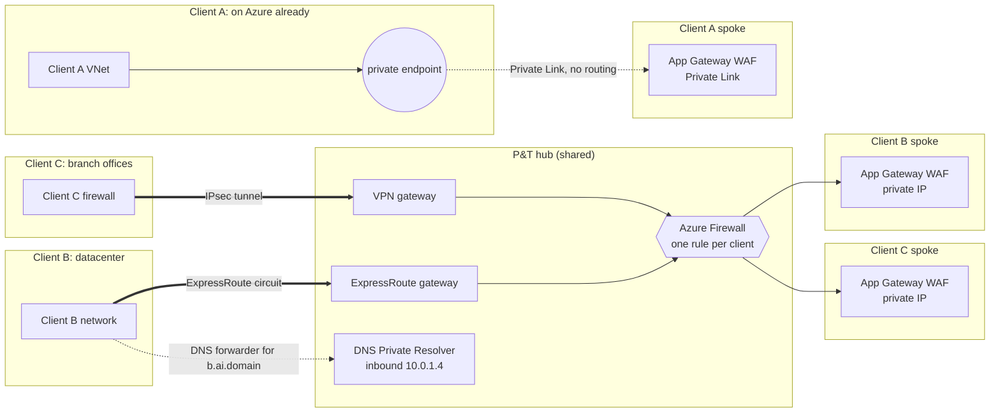
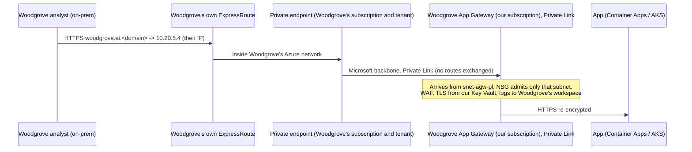
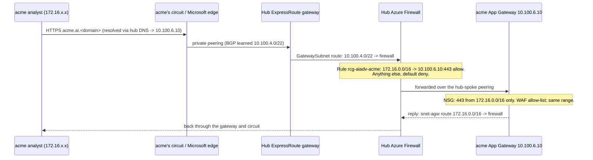
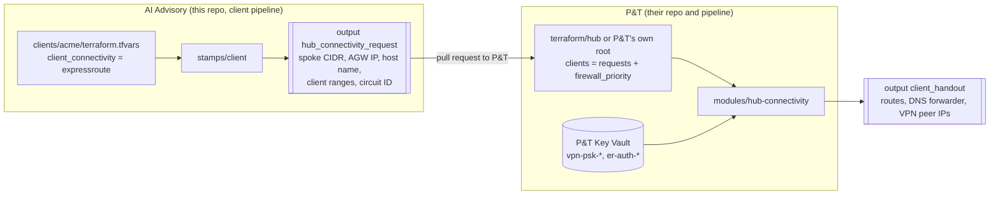

# Client network connectivity: Private Link, ExpressRoute and VPN

How a client's own network (their offices, their datacenter, or their own Azure) gets a private
path to *their* environment in our platform, without that path ever leading to another client.
The decision and trade-offs are in [ADR 0013](../adr/0013-client-network-connectivity.md); this
page explains how it works. Terms in **bold** are defined in plain words in the
[glossary](#networking-terms-in-plain-words) at the end.

## The short version

Every client already has a private front door: an Application Gateway with a WAF and a private IP
in their own spoke ([ADR 0010](../adr/0010-private-ingress-app-gateway-waf.md)). The question is
only how the client's network reaches that private IP. There are four answers, set per client with
one input, `client_connectivity`, in `terraform/clients/<code>/terraform.tfvars`:

| `type` | How the client gets in | Goes through P&T's shared hub? | IP ranges must be unique? | Use it when |
|---|---|---|---|---|
| `privatelink` | A **private endpoint** in the client's *own* Azure subscription, connected to their App Gateway | No | No | The client already runs in Azure (most banks and insurers now do). **Preferred.** |
| `expressroute` | The client's **ExpressRoute** circuit, linked to P&T's hub **ExpressRoute gateway** | Yes | Yes | The client has no Azure footprint but does have ExpressRoute, or needs a dedicated circuit |
| `vpn` | A **site-to-site VPN** (IPsec tunnel over the internet) from the client's firewall to P&T's hub **VPN gateway** | Yes | Yes (or NAT) | Smaller clients, quick starts, or as a backup for ExpressRoute |
| `none` | No private path. Internet users through a locked-down public frontend or Front Door, or Chatham staff only | No | n/a | Internet-based clients (e.g. `meridian`), internal canary |

Private Link is preferred because it is **not routing**. The client's network never learns any of
our IP ranges, our hub never learns theirs, and two clients with the same addresses don't matter.
ExpressRoute and VPN are **Layer 3** connections: they join the client's network to the hub's
network with routers, so the hub has to keep every client apart with routes, firewall rules and
NSGs. This design does that, and the Terraform refuses to plan anything that would break it.

## Option 1: Private Link (preferred for clients on Azure)

**What happens.** We switch on App Gateway **Private Link** on the client's gateway. The client
creates a private endpoint in a subnet of *their* VNet, pointing at our gateway's resource ID with
the target sub-resource `private` (the name of the private frontend). The endpoint shows up on our
side as a pending connection; we approve it only if it comes from one of the client's subscriptions
listed in their config (`private_link.consumer_subscription_ids`), using
[`scripts/approve-private-endpoints.sh`](../../scripts/approve-private-endpoints.sh). The client
points `<client>.ai.<domain>` at their endpoint's IP in their own DNS. Their on-prem users reach it
the way they reach anything else in their Azure, typically over the ExpressRoute they already have.

**Why it's the strongest option.** Nothing is routed. Our hub never carries Woodgrove's traffic, so
there is no shared gateway, no shared firewall rule set, and no route table where two clients meet.
The client's IP ranges can be anything, including the same as another client's or ours. The only
thing the client can reach is the one frontend the endpoint points at, and access is an explicit,
logged approval that we can revoke.

**What the Terraform does** (`client_connectivity = { type = "privatelink", ... }`):
- `modules/spoke-network` adds `snet-agw-pl` (`x.x.1.128/27`), with Private Link Service network
  policies off, as App Gateway requires. Each address in it carries up to 64k concurrent connections.
- `modules/app-gateway` adds a `private_link_configuration` and attaches it to the **private**
  frontend. The listener stays on the private frontend.
- The App Gateway NSG admits 443 **only** from `snet-agw-pl`.
- Output `private_link_offer` gives the client the gateway ID and sub-resource name.
- Works in `standalone` and `landing_zone` mode: the hub isn't involved.

**Things to know.**
- App Gateway Private Link [isn't supported on the private-only deployment](https://learn.microsoft.com/azure/application-gateway/application-gateway-private-deployment)
  ADR 0010 uses for private frontends. A Private Link gateway therefore keeps a Standard public IP for
  Azure's control plane. **Nothing listens on it**, and the NSG never admits 443 from the internet.
- Private Link to App Gateway has an [idle timeout of about 5 minutes](https://learn.microsoft.com/azure/application-gateway/private-link).
  Streaming completions keep the connection busy, but the client's proxies should use TCP keepalives
  under 300 seconds.
- App Gateway logs the original client IP and the private endpoint's link ID, so each request can be
  traced to the endpoint it came through even if the client's ranges overlap someone else's.
- Private Link translates connections to addresses from `snet-agw-pl` before they reach the gateway,
  which is why the NSG admits that subnet. Microsoft documents the logging behaviour but not what the
  subnet NSG sees, so the runbook confirms it with NSG flow logs on the first Private Link client.
- The client creates the DNS record. Private Link to App Gateway doesn't create one.

## Option 2: ExpressRoute through P&T's hub

**What it is.** An ExpressRoute **circuit** is a private connection from the client's datacenter,
through a connectivity provider (Equinix, AT&T, Megaport and similar), to Microsoft's edge routers
at a **peering location**. It never crosses the public internet, has an SLA, comes in fixed
bandwidths (50 Mbps to 10 Gbps, up to 100 Gbps with ExpressRoute Direct), and the two sides
exchange routes with **BGP** over **private peering**.

**Whose circuit.** Normally the client already has a circuit (most regulated firms do). They issue
an **authorization key** on it for us, and P&T links it to the hub's ExpressRoute gateway. The key
goes into P&T's Key Vault as `er-auth-<client>`; it is never committed. If a client has no circuit,
they order one from a provider, and the same steps follow once it is provisioned.

## Option 3: Site-to-site VPN through P&T's hub

**What it is.** An encrypted **IPsec** tunnel over the internet from the client's firewall to the
hub's VPN gateway. Cheaper than ExpressRoute and can be live in days, but latency follows the
internet and throughput depends on the gateway size (roughly up to 10 Gbps on the top SKU, shared
by every client on that gateway). Often used as the backup path for an ExpressRoute client.

**How we set it up.** One **local network gateway** per client (their device's public IP and their
ranges), one connection with a pre-shared key (P&T's Key Vault, `vpn-psk-<client>`) and a strong
IKEv2 policy (AES256/SHA384/ECP384 for IKE, GCMAES256 for IPsec, PFS ECP384). The gateway runs
**active-active**, so the client builds two tunnels, one to each gateway IP.

**BGP is off for client tunnels.** With BGP on, a VPN gateway
[passes routes it learns from one BGP peer to every other peer](https://learn.microsoft.com/azure/vpn-gateway/vpn-gateway-bgp-overview).
On a shared gateway that would tell client A how to reach client B's office. Client ranges are set
statically on each client's local network gateway instead. Onboarding checks what the gateway
advertises to each client (see the [runbook](../runbooks/connect-client-network.md)).

**Overlapping addresses: NAT.** Many companies use the same private ranges (`10.0.0.0/8`,
`172.16.0.0/12`, `192.168.0.0/16`). If a VPN client's range collides with another client or a spoke,
the VPN gateway translates it with a static 1:1 **NAT** rule: the client keeps `172.16.40.0/24`
at home and appears in Azure as `100.64.12.0/24`, a unique range P&T hands out from the
`100.64.0.0/10` shared address space. Every Azure-side control (firewall rule, NSG, WAF allow-list,
return route, local network gateway) uses the translated range. NAT needs VpnGw2AZ or larger.
ExpressRoute gateways can't NAT, so an overlapping ExpressRoute client must NAT on their own edge
(advertise a unique range to us), or use Private Link.

## Keeping clients apart in a shared hub

ExpressRoute and VPN put every routed client onto the same hub. The design makes sure that being
connected to the hub never means being connected to each other, with controls in both P&T's hub
and the client's spoke, all generated from the same `on_prem_prefixes` list so they can't drift:

| # | Where | Control | What it stops |
|---|---|---|---|
| 1 | Hub GatewaySubnet | Route per client spoke -> firewall (`azurerm_route.gateway_to_spoke`) | Client traffic skipping the firewall on its way to any spoke |
| 2 | Hub firewall | One rule collection group per client: **its** ranges -> **its** App Gateway IP, TCP 443. Default deny. | Client A reaching client B's spoke, or anything in client A's spoke other than the front door |
| 3 | Client spoke, `snet-agw` NSG | 443 only from that client's ranges. Never the `VirtualNetwork` tag, which also matches every network the hub gateway has learned | Same as 2, enforced again inside the client's own subscription |
| 4 | Client spoke, WAF | IP allow-list = the client's ranges | Same again at layer 7, logged in the client's workspace |
| 5 | Client spoke, `snet-agw` route table | Client ranges -> hub firewall; gateway route propagation **off** | Asymmetric routing (the firewall must see both directions), and the spoke learning other clients' networks |
| 6 | Hub VPN gateway | BGP off on client tunnels | One client learning another client's routes |
| 7 | Hub ExpressRoute gateway | `remote_vnet_traffic_enabled = false`; circuits never transit to each other | A client's own Azure VNets on the same circuit hair-pinning into our hub; circuit-to-circuit paths |
| 8 | Hub peering | Gateway transit only for `vpn`/`expressroute` spokes | Spokes with no client network learning or being advertised to client networks |
| 9 | CI / plan time | `modules/cidr-overlap`: no client range may overlap the hub, any spoke, or another client | Ambiguous routing, the most common real-world failure in multi-client hubs |

**What a routed client can still see, said plainly.** The hub's ExpressRoute gateway advertises the
hub and every gateway-transit spoke to every circuit, so acme's routers learn that `10.100.12.0/22`
exists. They can't reach anything there (controls 1 to 4), but they see the prefix. The DNS resolver
answers any name it knows to anyone who can reach it, so a client could resolve another client's
host name to an IP it can't reach. Both are metadata, not data, and both disappear with Private Link.
If a client's risk team won't accept them, the answer is Private Link, or (rarely) a dedicated hub
for that client ([ADR 0013](../adr/0013-client-network-connectivity.md), option D).

## IP address planning

- **Spokes**: one `/22` per client from P&T's IPAM (unchanged).
- **Client networks**: recorded per client in `client_connectivity.on_prem_prefixes`, as seen in
  Azure (post-NAT). Keep them as narrow as the client allows: the users' subnets, not `10.0.0.0/8`.
- **NAT pool**: `100.64.0.0/10`, carved into `/24`s per VPN client by P&T.
- **Checks**: the stamp refuses a client network that overlaps its own spoke. The hub module refuses
  any overlap between the hub, any spoke and any client network, and duplicate firewall priorities.
  Both fail in the pull request, before anything reaches Azure.

## DNS

The listener host name (`acme.ai.chatham.example.com`) has a public certificate, so it has to
resolve to the private IP for the client's users:

- **ExpressRoute / VPN clients**: the hub module creates a private DNS zone named exactly after the
  client's host name, with one record (`@` -> App Gateway IP), linked to the hub VNet. The client
  adds a **conditional forwarder** for that one name to the resolver's inbound endpoint
  (`10.0.1.4`). A zone per client means each client's DNS team forwards one name, not a shared domain.
- **Private Link clients**: the client creates the record in their own DNS, pointing at their
  private endpoint's IP.
- **What clients route to us**: only two addresses, their App Gateway IP and the DNS forwarder
  (`client_handout.routes_to_azure` in the hub output).

## Terraform shape: who applies what

| Piece | Owner | Path |
|---|---|---|
| Per-client input and spoke-side controls (NSG, WAF, return routes, Private Link, peering flag) | AI Advisory | `terraform/stamps/client`, `modules/spoke-network`, `modules/app-gateway` |
| Gateways, connections, NAT, GatewaySubnet routes, firewall rules, DNS zones and resolver, hub-side peering | P&T (we propose the module) | `terraform/modules/hub-connectivity` |
| Reference hub for demos and for P&T to compare against their own | P&T | `terraform/hub` |
| Overlap check used by both | Shared code | `terraform/modules/cidr-overlap` |

The stamp **generates** the request P&T needs (`terraform output hub_connectivity_request`), so no
one retypes a CIDR or an IP between teams. Secrets never go through us: the client sends the VPN
key or ExpressRoute authorization key to P&T, who store it in their Key Vault.

### Onboarding order (ExpressRoute or VPN)

1. **We** set `client_connectivity` in the client's tfvars and apply the stamp. The spoke gets its
   NSG, WAF allow-list and return routes; the plan prints `hub_connectivity_request`. A plan-time
   check warns that the client can't reach the spoke yet.
2. **P&T** adds the request to their hub `clients` map (plus a firewall priority) and applies: the
   connection, NAT, routes, firewall rule, DNS zone, and the hub side of the peering with gateway
   transit. They send the client the `client_handout`.
3. **We** set `hub.gateway_transit = true` and apply again: the spoke uses the hub gateway, so the
   gateway starts announcing the spoke to the client's network. The client builds their side
   (tunnels or circuit link, DNS forwarder, two routes) and we run the checks in the runbook.

Private Link is one step: apply the stamp, give the client `private_link_offer`, approve their endpoint.

## Limits and gotchas worth knowing

| Topic | Detail |
|---|---|
| ExpressRoute gateway size | ErGw1AZ links up to 4 circuits, ErGw2AZ 8, ErGw3AZ 16. The hub module refuses more ExpressRoute clients than the SKU allows. |
| GatewaySubnet | `/27` minimum, `/26` when ExpressRoute and VPN share it or more circuits are expected. Gateway route propagation must stay **on** there. |
| ExpressRoute public IP | Azure now auto-assigns and manages it; nothing to create. |
| VPN NAT | VpnGw2AZ or larger; static 1:1 only in this design; not with policy-based traffic selectors. |
| Shared gateway bandwidth | Every routed client shares the hub gateways' throughput. A client with heavy document uploads is a noisy-neighbour risk; watch gateway metrics per connection and size up, or give that client Private Link. |
| App Gateway with UDRs | Supported for specific prefixes and with propagation off, but Microsoft notes backend health can show "Unknown" with UDRs on the gateway subnet. Health probes still work; it's a portal display caveat to expect. |
| App Gateway Private Link | Dedicated subnet, dynamic IPs only, max 8 IPs, ~5 minute idle timeout, not on the private-only deployment. |
| Gateway transit ordering | The spoke can only use the hub gateway after P&T's side of the peering allows it, hence the three-step onboarding. |

## Networking terms in plain words

| Term | Plain words |
|---|---|
| **Layer 2 / Layer 3** | Networking is described in layers. Layer 2 is a single local network where machines find each other by hardware (MAC) address, like one office LAN. Layer 3 is IP addresses and routing between separate networks. A "Layer 3 connection" such as ExpressRoute joins two separate IP networks with routers that tell each other which address ranges they can reach. It doesn't merge them into one LAN. |
| **IP range, CIDR, prefix** | A block of addresses written like `10.100.4.0/22`. The number after the slash is how many leading bits are fixed: `/22` is 1,024 addresses, `/24` is 256. "Prefix" and "range" are used interchangeably. |
| **Overlapping ranges** | Two networks using some of the same addresses. A router can't tell which one a reply should go to, so overlapping networks can't be routed to each other without NAT. |
| **Routing, route table, UDR** | A route says "to reach this range, send packets to that next hop". Azure adds system routes automatically; a user-defined route (UDR) overrides them, for example "send everything to the firewall". |
| **BGP** | Border Gateway Protocol: how routers tell each other which ranges they can reach, automatically. ExpressRoute always uses it; VPN can. |
| **ASN** | Autonomous System Number: the ID each side uses in BGP. |
| **Route advertisement / propagation** | One side telling the other "I can reach this range". Propagation is Azure copying routes a gateway learned into subnets' route tables; it can be turned off per route table. |
| **Transit** | Traffic passing *through* a network on its way somewhere else, for example from client A through our hub to client B. The whole design is about preventing it. |
| **ExpressRoute circuit** | A private, dedicated connection from a company's network to Microsoft, delivered by a connectivity provider. Not over the internet. |
| **Peering location / Microsoft edge (MSEE)** | The colocation facility where the provider hands the circuit to Microsoft's edge routers. |
| **Private peering** | The part of an ExpressRoute circuit used to reach Azure VNets (as opposed to Microsoft 365 or public services). |
| **Layer 3 provider vs Layer 2 provider** | With a Layer 3 provider (most telcos), the provider runs the BGP session for you. With a Layer 2 / exchange provider (e.g. an Equinix cross-connect), you configure the BGP peering yourself. |
| **Authorization key** | A one-time key the circuit owner creates so someone else's gateway (ours) can link to their circuit. |
| **VNet gateway, GatewaySubnet** | The Azure router (ExpressRoute or VPN type) that connects a VNet to outside networks. It must live in a subnet named exactly `GatewaySubnet`. |
| **Site-to-site VPN** | An encrypted tunnel over the internet between two networks' firewalls or routers. |
| **IPsec / IKE** | IPsec encrypts the tunnel; IKE (version 2 here) is the handshake that agrees keys and algorithms. |
| **Pre-shared key (PSK)** | The shared secret both ends of a VPN tunnel use to authenticate each other. |
| **Local network gateway** | Azure's record of the *client's* side of a VPN: their device's public IP and the ranges behind it. |
| **Active-active** | Two gateway instances, each with its own public IP, both carrying traffic, so one can fail or be patched without an outage. |
| **NAT** | Network Address Translation: rewriting addresses as packets pass through, so an overlapping range can appear as a unique one. |
| **Hub and spoke** | One central "hub" VNet with shared services (gateways, firewall, DNS) and many "spoke" VNets connected to it, one per workload (here, one per client). |
| **VNet peering** | A private link between two VNets so they can talk directly. Each side creates its half. |
| **Gateway transit** | A peering setting that lets a spoke use the hub's VPN/ExpressRoute gateway, so the client network and the spoke learn routes to each other. |
| **Asymmetric routing** | Requests and replies taking different paths. Stateful firewalls drop it, because they only see half of each conversation. |
| **NSG** | Network Security Group: allow/deny rules on a subnet by source, destination and port. |
| **Azure Firewall rule collection group** | A named, prioritised set of firewall rules. We use one per client so each client's access is one auditable object. |
| **Private endpoint** | A network interface with a private IP in *your* VNet that connects to one specific service (here, one client's App Gateway) over Microsoft's backbone. |
| **Private Link** | The Azure feature behind private endpoints. No routes are exchanged, so address ranges on each side don't matter. |
| **DNS conditional forwarder** | A DNS server setting: "for this one name or domain, ask that other DNS server". |
| **DNS Private Resolver, inbound endpoint** | An Azure-managed DNS server with a private IP that outside networks can send DNS queries to, so they can resolve Azure private DNS zones. |
| **Service tag `VirtualNetwork`** | An NSG shorthand for "this VNet, peered VNets and networks connected through gateways". Too broad for client isolation in a shared hub, so this design doesn't use it for routed clients. |
