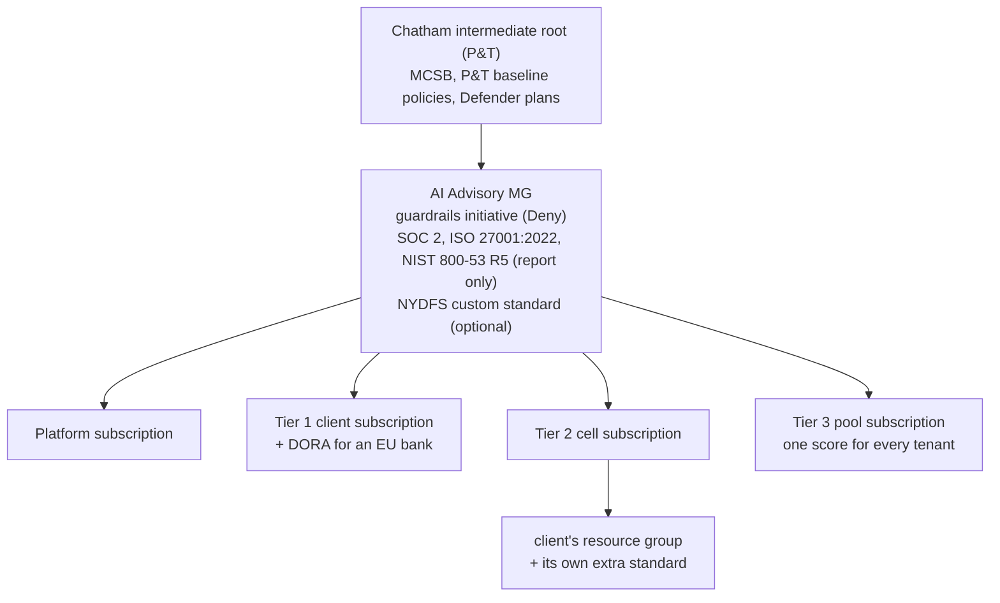

# Compliance standards with Microsoft Defender for Cloud

Which regulatory standards this platform would report against in Defender for Cloud, who assigns them and
where, what each isolation tier can show a client as evidence, how the repo's own Azure Policy rules show
up, and what Defender adds for the AI services. The decision is
[ADR 0016](../adr/0016-compliance-standards-defender-for-cloud.md); the Terraform is
[`terraform/modules/compliance-standards`](../../terraform/modules/compliance-standards). Like the policy
guardrails, it is a **proposal to Platform Engineering (P&T)**, who own Defender for Cloud
([ADR 0002](../adr/0002-work-inside-platform-engineering-guardrails.md)).

Every initiative ID and name below was checked on 2026-11-17 against Microsoft's built-in definitions
([Azure/azure-policy](https://github.com/Azure/azure-policy/tree/master/built-in-policies/policySetDefinitions))
and Defender's list of standards for Azure. Sources are at the end.

## Plain words first

- **Defender for Cloud:** Azure's security posture and threat detection service. It scores your
  configuration, raises alerts, and has a **regulatory compliance dashboard**.
- **Standard:** a framework (SOC 2, ISO 27001, DORA...) turned into automated checks. In Azure each built-in
  standard is an **Azure Policy initiative**: a set of audit policies, each tagged with the framework's
  control it evidences (for example SOC 2 `CC6.1`, NIST `SC-7`).
- **Automated vs manual controls:** a check can tell whether storage has public access off. It can't tell
  whether you trained your staff or ran a risk assessment. Most frameworks are mostly the second kind, so a
  green dashboard is **evidence for an audit, not a certificate**.
- **MCSB (Microsoft cloud security benchmark):** Microsoft's own baseline. It starts assessing as soon as
  Defender is on. Everything else you add.
- **Prerequisite:** standards beyond MCSB need a paid Defender plan ("any Defender for Cloud plan, except
  Defender for Servers Plan 1 or Defender for API Plan 1"), and `Owner` or `Policy Contributor` to add one.
- **Report-only:** an assignment in **DoNotEnforce** mode. Every check is still evaluated and scored;
  nothing is blocked or deployed.

## The short version

**Turn on for everyone** (assigned once at the AI Advisory management group, inherited by every client):

| Standard | Built-in initiative (GUID) | Why |
|---|---|---|
| Microsoft cloud security benchmark | `1f3afdf9-d0c9-4c3d-847f-89da613e70a8` | Default baseline. P&T assigns it at their intermediate root (Azure Landing Zones does), so it's inherited, not assigned again |
| SOC 2 Type 2 | `4054785f-702b-4a98-9215-009cbd58b141` | The first thing a bank's vendor-risk team asks for |
| ISO/IEC 27001 2022 | `5e4ff661-23bf-42fa-8e3a-309a55091cc7` | Common requirement for UK and European clients |
| NIST SP 800-53 Rev. 5 | `179d1daa-458f-4e47-8086-2a68d0d6c38f` | The detailed control set US banks map to, and the one that maps most of our guardrails (below) |

**Per client, when its contract or region needs it** (assigned at that client's scope, see "Per tier"):

| Standard | Built-in initiative (GUID) | Status | Use for |
|---|---|---|---|
| NIST CSF v2.0 | `184a0e05-7b06-4a68-bbbe-13b8353bc613` | GA | US banks. The FFIEC now points banks here |
| FFIEC CAT 2017 | `1d5dbdd5-6f93-43ce-a939-b19df3753cf7` | **Retired** | The FFIEC sunset the Cybersecurity Assessment Tool on 2025-08-31. Only for a client whose questionnaire still asks for it |
| DORA 2022 2554 | `f9c0485f-da8e-43b5-961e-58ebd54b907c` | GA | EU financial entities, and their ICT providers |
| EU 2022/2555 (NIS2) | `42346945-b531-41d8-9e46-f95057672e88` | GA | EU essential and important entities |
| EU GDPR 2016/679 | `7326812a-86a4-40c8-af7c-8945de9c4913` | GA | Personal data of EU residents |
| UK OFFICIAL and UK NHS | `3937f550-eedd-4639-9c5e-294358be442e` | GA | UK public-sector work |
| NCSC CAF v3.2 | `6d220abf-cf6f-4b17-8f7e-0644c4cc84b4` | GA | UK critical-infrastructure and regulated clients |
| PCI DSS v4.0.1 | `a06d5deb-24aa-4991-9d58-fa7563154e31` | GA | Only if an app ever touches card data (unlikely) |
| CIS Azure Foundations v3.0.0 | `470a962c-86a0-433b-803a-3c176b5ce79c` | GA | Hardening benchmark; better owned by P&T estate-wide |

**AI-specific:**

| Standard | Where it lives | Status | What it really checks |
|---|---|---|---|
| EU AI Act 2024 1689 | Built in, `1308bccf-446a-4283-a4e0-0c983fe7a572` | GA, **thin** | 6 checks: AI services diagnostic logs and Private Link, AI Search public access and SKU, API Management TLS, Defender for APIs |
| NIST AI RMF v1.0 | Built in, `f58a876c-ec25-417e-9634-58d2a93e3fe2` | GA, **thin** | 1 check: diagnostic logs on Azure AI services |
| MCSB v2 | Built in, `e3ec7e09-768c-4b64-882c-fcada3772047` | **Preview** in Defender | Adds "coverage for emerging workloads such as artificial intelligence". Try in a sandbox MG first |
| ISO/IEC 42001:2023 | **Not in Defender.** Purview Compliance Manager premium template | n/a | An AI management system standard: mostly process (policy, impact assessment, roles) |
| NYDFS 23 NYCRR Part 500 | **Not in Defender.** Compliance Manager premium template, plus a custom standard in this repo | Custom | `policy/standards/nydfs-part-500.json`: 18 built-in checks grouped by section (below) |

Newer siblings of three core standards are also built in and in the module's catalog: **SOC 2023**
(`53ad89f5-...`), **NIST SP 800-53 R5.1.1** (`60205a79-...`) and **PCI DSS v4** (`c676748e-...`,
superseded by v4.0.1). Pick one per framework so the dashboard doesn't count the same control twice.

## How it's assigned: once, at the AI Advisory management group



- **Inherited, not repeated.** A standard assigned at the AI Advisory MG covers every subscription below it,
  including ones vended next month. Onboarding a client adds nothing unless that client needs an extra standard.
- **Report only.** Every assignment is DoNotEnforce. Blocking stays with the guardrails initiative
  (`policy-guardrails`), so a standard can never break a deployment or fight one of P&T's assignments.
- **An identity with no roles.** Some standards include DeployIfNotExists rules (MCSB v2 does), and Azure
  refuses such an assignment without a managed identity. Each gets one, with no role assignments.
- **MCSB stays P&T's.** It is already assigned at their root; the module doesn't assign it again.
- **Who runs it.** P&T, from their pipeline, the same way as the guardrails. We can run it in a sandbox MG to
  prove it, as with `policy-guardrails`.

```hcl
module "compliance" {
  source                         = "../../modules/compliance-standards"
  assignment_management_group_id = "/providers/Microsoft.Management/managementGroups/ai-advisory"
  definition_management_group_id = "/providers/Microsoft.Management/managementGroups/chatham" # custom standards only
  standards                      = ["soc2", "iso27001-2022", "nist80053r5"]                  # the default
  custom_standards               = ["nydfs-part-500"]

  scoped_standards = {
    fabrikam  = { scope_id = "/subscriptions/<fabrikam-sub>", standards = ["dora"] }                               # Tier 1
    northwind = { scope_id = "/subscriptions/<cell01-sub>/resourceGroups/rg-northwind-prd-eus2", standards = ["dora"] } # Tier 2
  }

  exemptions = {
    cmk-gap-acme = {
      standard        = "soc2"
      subscription_id = "/subscriptions/<acme-sub>"
      reference_ids   = ["67121cc7-ff39-4ab8-b7e3-95b84dab487d", "6fac406b-40ca-413b-bf8e-0bf964659c25"]
      category        = "Waiver"
      expires_on      = "2027-06-30T00:00:00Z"
      reason          = "ADR 0016: customer-managed keys are a known gap, planned with self-hosted runners"
    }
  }
}
```

The module refuses an unknown standard, the retired FFIEC CAT estate-wide, a per-client standard that the MG
already gives everyone, and an exemption without an expiry date or an ADR reference. Offline tests:
`cd terraform/modules/compliance-standards && terraform test`.

## What each tier can show a client

| Tier | Where the score comes from | What the client gets | Limits |
|---|---|---|---|
| **1. Dedicated** | Defender's regulatory compliance dashboard, scoped to the client's own subscription | That subscription's report per standard, exported from the dashboard, plus extra standards assigned only to it | None: the subscription is the client |
| **2. Shared cell** | Azure Policy compliance in the cell's subscription, filtered to the client's resource group and to shared resources tagged with the client | A per-client export from Resource Graph (query below). A client-specific standard is assigned at its resource group | Defender assigns standards to subscriptions and management groups, so a resource-group standard shows in Azure Policy and Resource Graph, not as a Defender standard. The cell's shared edge, compute, gateway and search service (tag `client = shared`) count for every client in the cell |
| **3. Pooled** | The pool subscription's dashboard: one score for every tenant | The pool's report, plus the isolation tests (`stamps/pool/tests`) | A tenant's container, index and encryption scope are data inside shared resources, not separate resources Azure Policy scores. Tier 3 is for internal or public data (ADR 0014), so a client rarely needs its own attestation |

The `client` tag that the guardrails require on every resource group (and copy down to every resource) is
what makes the Tier 2 split possible.

**Tier 1: one client's subscription, per standard** (Defender's own result):

```kusto
securityresources
| where type == "microsoft.security/regulatorycompliancestandards"
| where subscriptionId == "<client subscription id>"
| project standard = name,
          state = tostring(properties.state),
          passedControls = toint(properties.passedControls),
          failedControls = toint(properties.failedControls),
          skippedControls = toint(properties.skippedControls)
```

**Tier 2: one client in a cell, per control** (Azure Policy's result, joined to the `client` tag):

```kusto
policyresources
| where type == "microsoft.policyinsights/policystates"
| where subscriptionId == "<cell subscription id>"
| where tostring(properties.policySetDefinitionName) == "4054785f-702b-4a98-9215-009cbd58b141" // SOC 2 Type 2
| extend resourceId = tolower(tostring(properties.resourceId)),
         state = tostring(properties.complianceState),
         controls = properties.policyDefinitionGroupNames
| join kind=leftouter (resources | project resourceId = tolower(id), client = tostring(tags.client)) on resourceId
| where client in ("northwind", "shared")   // the client's own resources, and the cell's shared ones
| mv-expand control = controls to typeof(string)
| summarize resources = dcount(resourceId), nonCompliant = dcountif(resourceId, state == "NonCompliant") by control, client
```

Both are written against the documented Resource Graph tables and haven't been run against a live tenant;
check them in Resource Graph Explorer before handing a result to a client.

The rest of an evidence pack is not in Defender: Microsoft's own SOC 2 and ISO reports for the Azure services
(Service Trust Portal, the provider's half of shared responsibility), the ADRs, and the CI test results that
assert the isolation rules.

## How the repo's guardrails show up in the standards

Defender scores a standard from the policies **inside that standard's initiative**. Our Deny rules in
`policy/` aren't in those initiatives, so they don't appear as controls themselves. What they do is make every
resource pass the built-in checks that measure the same setting, and keep it passing. The table shows which
built-in check that is, and which controls it counts for (read from the initiatives' JSON):

| Our rule (`policy/`) | Built-in check the standards run | MCSB | NIST 800-53 Rev. 5 | Also counted by |
|---|---|---|---|---|
| AI services: keys disabled | AI services local auth disabled (`71ef260a`) | IM-1 | AC-2, AC-2(1), AC-2(7), AC-3, IA-2, IA-4 | NYDFS 500.7 (custom) |
| AI services: public network off | AI services restrict network access (`037eea7a`) | NS-2 | AC-4, SC-7, SC-7(3) | NYDFS 500.3 (custom) |
| | AI services use Private Link (`d6759c02`) | NS-2 | | DORA 9.3a; PCI DSS v4.0.1 1.2.1, 1.2.7, 1.4.4; FFIEC CAT 3.1.1, 4.1.1; EU AI Act 15.5, 55.1d |
| Storage, Key Vault, AI Search: public network off | Storage restricts network access (`34c877ad`) | NS-2 | AC-4, AC-17, AC-17(1), SC-7, SC-7(3) | CIS Azure v3.0.0 4.7 |
| | Storage uses Private Link (`6edd7eda`) | NS-2 | AC-4, AC-17, AC-17(1), SC-7, SC-7(3) | DORA 9.3a; CIS Azure v3.0.0 4.9 |
| | Key Vault private endpoint (`a6abeaec`) and firewall (`55615ac9`) | NS-2, DP-8 | AC-4, SC-7, SC-7(3) | DORA 9.3a; PCI DSS v4.0.1 1.4.4 and FFIEC CAT 3.1.1, 4.1.1 (firewall) |
| | AI Search public access disabled (`ee980b6d`) | NS-2 (v2 only) | AC-4, SC-7, SC-7(3) | EU AI Act 15.5, 55.1d |
| Allowed model deployment SKUs | No built-in check exists | | | Residency evidence is the rule itself and its compliance report |
| Allowed locations (built-in `e56962a6`) | Not part of any of these standards | | | Same |
| Required tags, tag inheritance | Not part of any of these standards | | | Makes per-client reporting possible (Tier 2 query above) |
| Private DNS registration (DINE) | Not part of any of these standards | | | Makes private endpoints resolve, so the Private Link checks pass in practice |

SOC 2 Type 2 and ISO 27001:2022 count none of the network checks above. Their built-ins test other things,
which is worth knowing before a client reads the score:

- **ISO/IEC 27001 2022** has 58 checks, mapped to the standard's clauses 6 to 10 (planning, operation,
  monitoring, improvement), not to Annex A. Most are "this Defender plan is on", logging and retention, and
  encryption with your own keys. Its score mostly says whether Defender and logging are on.
- **SOC 2 Type 2** network checks are NSG-based (subnets and VMs), plus secure transfer, Key Vault soft delete
  and purge protection, customer-managed keys (CC6.1) and Defender plans (CC7.2).

What the standards measure beyond our rules, and where the stamps stand:

| Result | Checks | Counted under |
|---|---|---|
| **Should pass by design** | AI services diagnostic logs (`1b4d1c4e`; the stamp sends them to the client's workspace, ADR 0009); Key Vault purge protection (`0b60c0b2`); API Management in a VNet (`ef619a2c`) with encrypted protocols only (`ee7495e7`), which is the internal AI gateway (ADR 0012); Container Apps internal only (`783ea2a8`) | MCSB LT-3, NS-2, DP-3; SOC 2 CC6.1; NIST AC-4, SC-7; DORA 9.3a, 9.3b; EU AI Act 12.1, 12.2, 15.5, 55.1d; NIST AI RMF |
| **Depends on P&T's Defender plans** | Defender CSPM (`1f90fc71`), Storage (`640d2586`), Key Vault (`0e6763cc`), Resource Manager (`c3d20c29`), APIs (`7926a6d1`), Containers (`1c988dd6`) enabled | ISO 27001:2022 9.1, 10.2 (and 7.5.3, 9.3.3 for most); SOC 2 CC7.2; NIST CSF DE.CM; DORA 10.1, 10.2 |
| **Fails today (known gap)** | Customer-managed keys on AI services (`67121cc7`) and storage (`6fac406b`) | SOC 2 CC6.1; NIST SC-12; DORA 9.3b, 9.3c; CIS Azure v3.0.0 6.1.3 |

MCSB ships its customer-managed-key checks **disabled by default**, so the MCSB score hides the gap; SOC 2,
NIST and DORA audit them and will show it. Record it as an exemption (Waiver, with an expiry date and this
ADR) until customer-managed keys land, so it reads as an accepted, dated risk rather than an unexplained red
control.

## Custom standard: NYDFS Part 500

Defender has no built-in NYDFS standard. Chatham's bank clients that are NYDFS-covered entities must manage
the security of their third-party service providers (500.11), so the questionnaire reaches us anyway.
`policy/standards/nydfs-part-500.json` builds one from built-in audit checks, grouped by section, so Defender
shows a score per section:

| Section | Checks |
|---|---|
| 500.3 Cybersecurity policy: systems and network security | AI services restrict network access and use Private Link; storage Private Link; AI Search public access off |
| 500.5 Vulnerability management | Defender CSPM on |
| 500.6 Audit trail | Diagnostic logs on AI services |
| 500.7 Access privileges and management | AI services keys disabled |
| 500.14 Monitoring and training | Defender for Storage, Key Vault, Resource Manager and APIs on |
| 500.15 Encryption of nonpublic information | Secure transfer to storage; API Management encrypted protocols; customer-managed keys (known gap) |
| 500.16 Incident response and business continuity | High-severity alert email; security contact; Key Vault purge protection |

It is **our mapping**, not Microsoft's and not legal advice, and it covers configuration only. Governance,
the CISO role, risk assessment, training and notification need written evidence (Compliance Manager's
"New York - 23 NYCRR Part 500" template is the place for that). The initiative carries `metadata.ASC = "true"`,
which is how an Azure Policy initiative is onboarded to Defender as a standard; Microsoft calls that route
legacy, and its newer custom standards are built in the portal with no Terraform resource yet. Add a section
by adding a check to the JSON: the module refuses a check that names a section the file doesn't define, or
that isn't a policy definition GUID.

## Defender for Cloud's AI protections

**AI security posture management** is part of the **Defender CSPM** plan. It discovers Azure OpenAI, Azure AI
Foundry and Azure Machine Learning (AI Search isn't on Microsoft's list), builds an AI bill of materials, raises
recommendations on identity, data security and internet exposure, and finds attack paths, for example an
internet-exposed endpoint that can reach a model with access to sensitive data. Agent-level posture for Foundry
agents needs a Microsoft Agent 365 license from 2026-07-01; this platform runs no agents yet.

**Threat protection for AI services** is its own plan ("Defender for AI Services"), generally available,
enabled per subscription. With Azure AI Content Safety Prompt Shields and Microsoft threat intelligence it
alerts on jailbreak, data leakage, data poisoning, credential theft and more, for Azure OpenAI and Azure AI
Model Inference models (text only), and sends alerts to Defender XDR next to P&T's other incidents. It
complements, not replaces, the content filter on every deployment (ADR 0015) and the gateway's optional Prompt
Shields (ADR 0012): the filter blocks, Defender detects and correlates.

Two settings need a decision per client:

- **Suspicious prompt evidence** puts the suspicious parts of prompts and responses (sensitive data redacted)
  into the alert. That is client content leaving the client's own Log Analytics workspace (ADR 0009) for the
  security team's tools. **Off by default**; on for a client only with its written agreement. With it off,
  Defender still analyses prompts and raises alerts, but masks the content.
- **Data security for AI interactions** (Microsoft Purview) needs a separate Purview license and only sees
  calls made with a user's token. Tiers 1 and 2 call models as the app's managed identity, so it would see
  little there; Tier 3 reads with the user's token.

**Plans to ask P&T for** on AI Advisory subscriptions, and what each adds: Defender CSPM (AI posture, attack
paths, and most of the ISO 27001 score), AI Services (prompt attack alerts), Storage (documents), Key Vault,
Resource Manager, APIs (the AI gateway), and Containers for AKS clients. P&T can enforce them on every vended
subscription with the built-in DeployIfNotExists initiative **Configure Microsoft Defender for Cloud plans**
(`f08c57cd-dbd6-49a4-a85e-9ae77ac959b0`), which includes Defender CSPM and Defender for AI. Without at least
one paid plan, the dashboard shows only MCSB.

## Rolling it out

1. Confirm with P&T which Defender plans are on and that MCSB is assigned at their root.
2. Apply the module to a sandbox MG, read the dashboard, then the AI Advisory MG.
3. Read the failing controls. Fix them, or exempt them with an expiry date and an ADR (the known CMK gap first).
4. Add a client's extra standards in the same pull request that onboards the client
   ([onboarding runbook](../runbooks/onboard-a-client.md): step 1g for Tier 1, step 2 of Tier 2).
5. Before quoting a standard to a client, check its current name and version in the Defender portal:
   built-in versions change without notice; the GUIDs don't.

## Interview questions and answers

**"If we used Defender for Cloud with this platform, which compliance standards would you turn on?"**
MCSB is always there; P&T assigns it at the root. On top I'd assign SOC 2 Type 2, ISO 27001:2022 and NIST
800-53 Rev. 5 once at the AI Advisory management group, because that's what bank and insurer clients ask for.
Then per client: DORA for EU financial clients, NIST CSF 2.0 for US banks, UK OFFICIAL or NCSC CAF for the UK,
PCI only if card data appears. For AI, the EU AI Act and NIST AI RMF are built in but thin, so I'd treat them
as a start, not evidence.

**"Who assigns them, and where?"**
P&T, because they own Defender and Policy. I'd hand them a module, like the guardrails: assigned once at our
management group, report-only, so every vended subscription inherits them and they can never block a
deployment. Blocking stays with the guardrails initiative.

**"How do you give one client evidence of their own compliance?"**
It depends on the tier. Tier 1 is a subscription, so Defender's dashboard for that subscription is the
client's report. In a shared cell I filter Azure Policy compliance to the client's resource group plus the
shared resources, using the `client` tag the guardrails enforce. In the pooled tier there's one score for all
tenants, which is one reason Tier 3 is only for internal or public data.

**"Do your own Azure Policy deny rules show up as controls in the dashboard?"**
Not directly. The dashboard scores the built-in policies inside each standard. Our deny rules make resources
pass the built-in checks for the same settings: keys off counts for MCSB IM-1 and NIST IA-2, for example. If
we want our own rules scored, a custom initiative with control groups does it, which is how the NYDFS standard
here is built.

**"Is a green SOC 2 score in Defender the same as being SOC 2 compliant?"**
No. It covers the automated part of the configuration controls. An auditor also needs process evidence, the
provider's own SOC 2 report for the Azure services, and a period of operation. The dashboard is useful evidence
and a good way to catch drift.

**"What would fail if you turned this on today?"**
Customer-managed keys. SOC 2 CC6.1, NIST SC-12 and DORA 9.3 audit them, and the stamps don't use them yet
(a known gap). MCSB has those checks off by default, so the MCSB score hides it. I'd exempt them with an expiry
date and an ADR so it shows as an accepted risk with a plan. Defender plan checks also fail if P&T hasn't
enabled the plans, and that drives most of the ISO 27001 score.

**"What does Defender add for the AI services specifically?"**
Two things. AI security posture management, in Defender CSPM, discovers the AI services and models, flags
misconfigurations and finds attack paths. Threat protection for AI services alerts on jailbreaks, data leakage
and credential theft in model traffic, and sends them to Defender XDR. I'd keep prompt evidence in alerts off
unless the client agrees, because it moves prompt content out of the client's workspace.

**"Isn't the FFIEC CAT the standard for US banks?"**
It was. The FFIEC retired it on 31 August 2025 and pointed banks to NIST CSF 2.0 and CISA's Cybersecurity
Performance Goals. Defender still has the FFIEC CAT 2017 initiative, so I'd only assign it for a client whose
questionnaire still asks for it.

## Sources (checked 2026-11-17)

- Built-in initiative definitions: [Azure/azure-policy, policySetDefinitions](https://github.com/Azure/azure-policy/tree/master/built-in-policies/policySetDefinitions)
  and the [built-in initiatives index](https://learn.microsoft.com/en-us/azure/governance/policy/samples/built-in-initiatives)
- [Regulatory compliance standards in Defender for Cloud](https://learn.microsoft.com/azure/defender-for-cloud/concept-regulatory-compliance-standards),
  [assign standards](https://learn.microsoft.com/en-us/azure/defender-for-cloud/assign-regulatory-compliance-standards),
  [MCSB in Defender for Cloud](https://learn.microsoft.com/en-us/azure/defender-for-cloud/concept-regulatory-compliance),
  [custom standards](https://learn.microsoft.com/en-us/azure/defender-for-cloud/custom-security-policies)
- [AI security posture management](https://learn.microsoft.com/azure/defender-for-cloud/ai-security-posture),
  [threat protection for AI services](https://learn.microsoft.com/en-us/azure/defender-for-cloud/ai-threat-protection),
  [enable it](https://learn.microsoft.com/en-us/azure/defender-for-cloud/ai-onboarding)
- [Purview Compliance Manager regulations list](https://learn.microsoft.com/purview/compliance-manager-regulations-list)
  (ISO/IEC 42001:2023, NIST AI RMF 1.0, EU AI Act, 23 NYCRR Part 500, DORA, FFIEC)
- [OCC Bulletin 2024-25: FFIEC CAT sunset](https://occ.gov/news-issuances/bulletins/2024/bulletin-2024-25.html)
