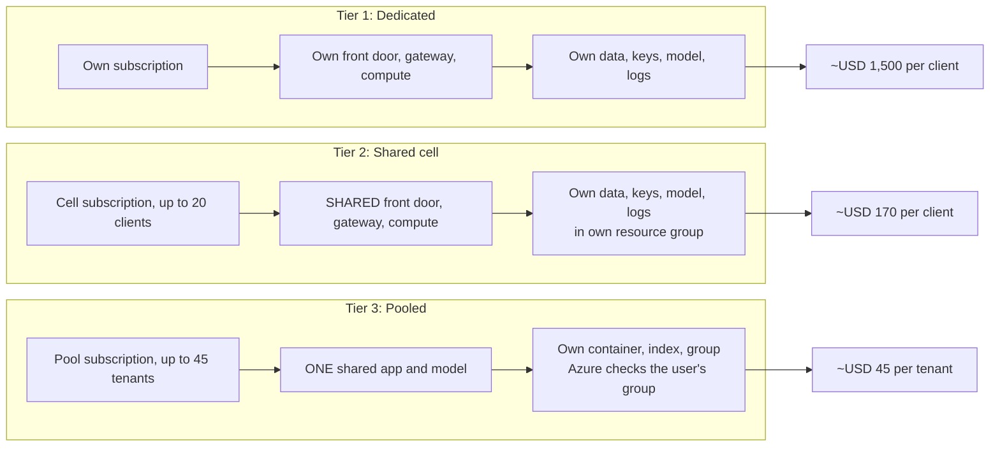
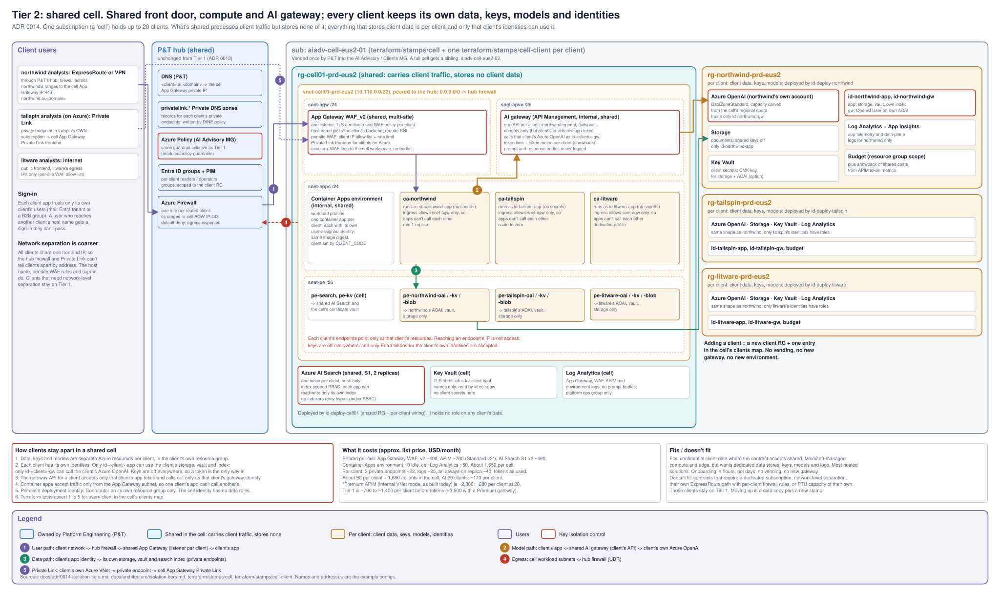
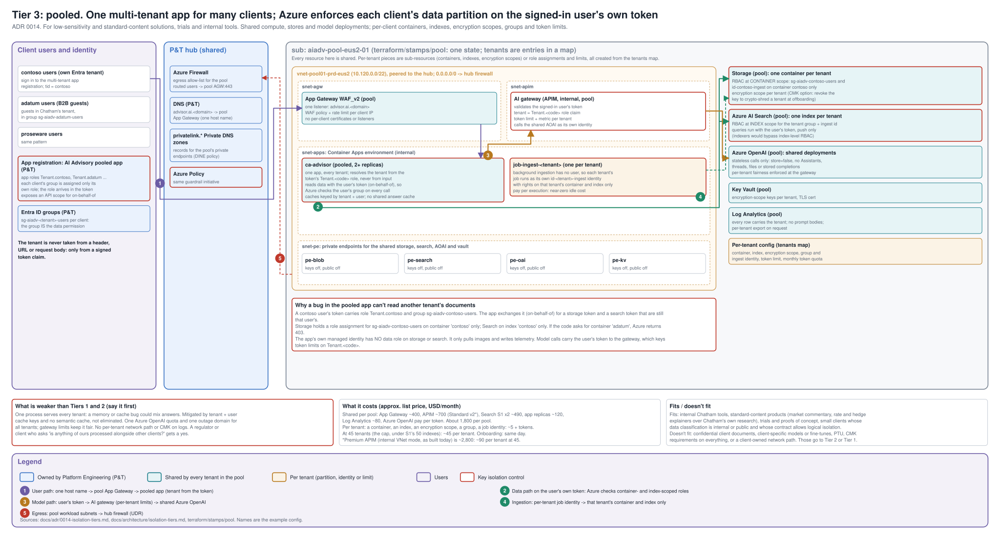
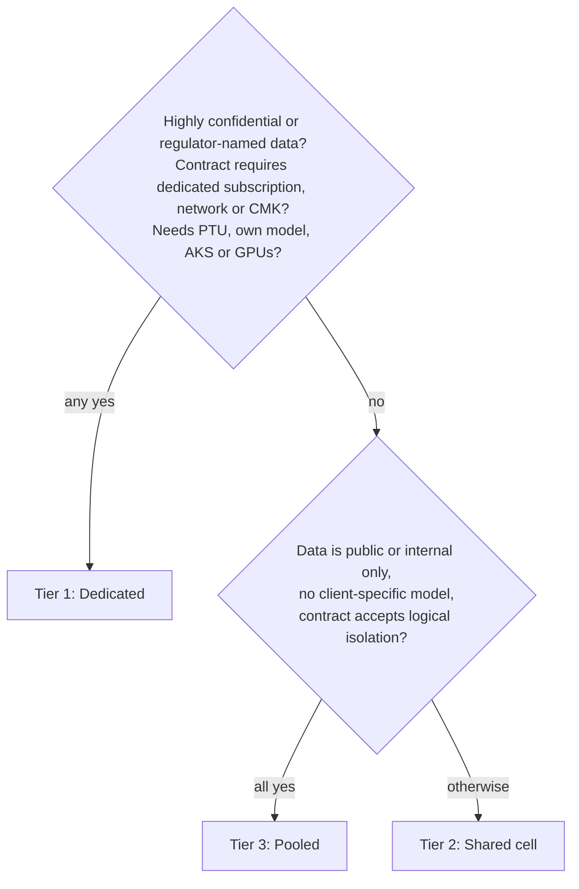

# Isolation tiers: three ways to host a client, from most to least isolated

Decision record: [ADR 0014](../adr/0014-isolation-tiers.md) (proposed). This page explains the design in
plain words, with diagrams, the cost math and the questions an interviewer is likely to ask.

## The idea in one paragraph

Until now every client got its own Azure subscription with its own copy of everything (Tier 1,
[ADR 0001](../adr/0001-tenancy-subscription-per-client.md)). That is the safest option and also the most
expensive, because the pricey parts (the App Gateway front door, the API Management AI gateway, search
units, always-on app replicas) are paid for per client even when the client barely uses them. Those
pricey parts don't **store** anything. The parts that do store client data (a storage account, a Key
Vault, a search index, an Azure OpenAI account, a Log Analytics workspace) are cheap or free to have one
of per client. So the two cheaper tiers **share the expensive, stateless parts and keep the cheap,
stateful parts per client**, and they rely on Azure (identities and role assignments) rather than our
own code to keep clients apart.

## Side by side

| | Tier 1: Dedicated | Tier 2: Shared cell | Tier 3: Pooled |
|---|---|---|---|
| In one sentence | A private copy of everything | Shared building, separate locked rooms | One room, a locked cupboard per tenant, and the lock checks *your* badge |
| What's shared | Only P&T's hub | Network, App Gateway, Container Apps environment, API Management, search service | Everything except the per-tenant pieces |
| What's per client | Everything | Storage, Key Vault, search index, Azure OpenAI account, logs, identities, budget | Blob container + encryption scope, search index, Entra group, ingestion identity, token limit |
| Who stops client A reading client B's data | Azure: different subscription | Azure: B's data only accepts B's identities (keys are off) | Azure: B's container and index only accept B's users' tokens; the app itself has no access at all |
| What our code must get right | Nothing extra | Nothing extra for data; routing config is tested | Must not mix tenants in memory or caches |
| Data allowed | Up to highly confidential | Up to confidential | Public and internal only (Terraform refuses more) |
| Fixed cost (USD/month, approx.) | ~1,500 per client (~3,600 with Premium APIM) | ~1,650 per cell + ~90 per client = **~170 per client** at 20 | ~1,800 per pool + ~5 per tenant = **~45 per tenant** at 45 |
| Onboarding | Days to weeks elapsed: P&T vends a subscription, peers it, requests quota | Hours: three small pull requests | Same day: one map entry plus a P&T group |
| Blast radius of a bad change | 1 client | Up to 20 clients in the cell | Up to 45 tenants in the pool |
| Terraform | [`stamps/client`](../../terraform/stamps/client) | [`stamps/cell`](../../terraform/stamps/cell) + [`stamps/cell-client`](../../terraform/stamps/cell-client) | [`stamps/pool`](../../terraform/stamps/pool) |
| Example config | `terraform/clients/acme` | `terraform/cells/cell01` | `terraform/pools/pool01` |

Prices are approximate list prices for a US region, to show the shape of the saving. Check the Azure
pricing calculator before quoting them.

## Tier 2: shared cell

PNG: [tier2-shared-cell.png](diagram/tier2-shared-cell.png). Editable: [tier2-shared-cell.drawio](diagram/tier2-shared-cell.drawio).

**What a "cell" is.** One subscription that hosts up to 20 clients. Azure's Architecture Center calls this
pattern *horizontally partitioned*: the front of the system is shared, the data at the back is not. When a
cell is full, we open `cell02`; we don't make `cell01` bigger, because a cell is also the blast radius of a
bad change.

**How a request flows (numbers match the diagram).**
1. A northwind user opens `northwind.ai.<domain>`. Their network routes it through P&T's hub firewall to
   the cell's App Gateway. The App Gateway picks northwind's **site** by host name: northwind's
   certificate, northwind's WAF policy, northwind's allowed IP ranges.
2. The site forwards to `ca-northwind`, northwind's own container app. It runs as `id-northwind-app`.
3. For a model call, the app calls the shared API Management on the path `/northwind/openai`. That API
   only accepts a token from `id-northwind-app`, and it calls northwind's Azure OpenAI account **as**
   `id-northwind-gw`, which is the only identity with access to that account.
4. For documents, the app reads northwind's storage, vault and search index directly over private
   endpoints, as `id-northwind-app`.
5. A client already on Azure can reach its site through Private Link instead of the hub.

**Why tailspin can't see northwind's data, even though they share a gateway and an environment.**
- Every data store has keys turned off, so a token is the only way in.
- The only identities with a role on northwind's data are northwind's. `ca-tailspin` runs as
  `id-tailspin-app`, which Azure refuses at northwind's storage, vault and index.
- API Management holds every client's gateway identity, but each client's API policy names its own
  (`authentication-managed-identity client-id="..."`) and accepts only its own app's token. The
  policies are rendered by Terraform and asserted in `stamps/cell/tests`.
- Container apps only accept traffic from the App Gateway subnet, so apps can't call each other.
- Each client's pipeline has its own deployment identity, and the cell gives it rights on **that
  client's resource group only** (plus "join" on the shared endpoint subnet). It can't touch the shared
  resources or another client's group, and its RBAC Administrator role is limited by an Azure ABAC
  condition to the six data roles the client root needs, so it can't hand out Owner.

**What is weaker than Tier 1 (say this first in an interview).**
- Network separation is coarser: clients share a VNet, a front-door IP and an endpoint subnet. Access
  is still blocked by identity, but a network-level control like "nothing in this VNet can even reach
  northwind's storage" is gone.
- Clients share Microsoft-managed compute (the Container Apps environment). Each app is its own
  container with its own identity, but they are neighbours.
- A misconfigured shared component (WAF policy baseline, APIM, App Gateway) affects up to 20 clients.
- Azure OpenAI quota is per subscription and region, so the cell's clients draw from one regional quota
  when we deploy. Once a deployment has capacity, nobody else can use it, so this is a planning limit,
  not a noisy-neighbour problem. Provisioned throughput (PTU) is Tier 1 only, enforced by validation.

**Onboarding a client to a cell (three pull requests, no subscription vending).**
1. **Cell PR:** add the client to `client_slots`. The cell creates `rg-<client>-prd-<region>` and gives
   the client's deployment identity its narrow rights there.
2. **Client PR:** add `terraform/cells/cell01/clients/<client>.tfvars`. `stamps/cell-client` builds the
   client's storage, vault, Azure OpenAI account, workspace and identities, with private endpoints in
   the cell's subnet. Its output `cell_registration` lists identity IDs and endpoints (no secrets).
3. **Cell PR:** add the client to `clients` with those values plus host name, certificate and limits.
   The cell adds the App Gateway site, container app, APIM API and search index role.

P&T still adds a DNS record and (for routed clients) a firewall rule, from the cell's
`hub_connectivity_request` output, the same handover as Tier 1.

## Tier 3: pooled

PNG: [tier3-pooled.png](diagram/tier3-pooled.png). Editable: [tier3-pooled.drawio](diagram/tier3-pooled.drawio).

**What it is.** One app (`ca-advisor`) serves many tenants from one host name. It is meant for
low-sensitivity work: internal Chatham tools, products built on Chatham's own research (market
commentary, hedge explainers), trials and proofs of concept.

**The rule that makes it safe enough: the app has no keys and no data role.** Normally an app reads
data as itself, so if the app has a bug, it can read anything it has access to. Here, the app's own
identity can only pull images and send telemetry. To read a tenant's documents it uses the **signed-in
user's own token**, exchanged for a storage or search token through the on-behalf-of flow, and Azure
checks that user's group on every call:

| Tenant | Entra group (P&T-owned) | Blob container | Search index | App role in the token |
|---|---|---|---|---|
| contoso | `sg-aiadv-contoso-users` | `contoso` (encryption scope `contoso`) | `contoso` | `Tenant.contoso` |
| adatum | `sg-aiadv-adatum-users` | `adatum` (encryption scope `adatum`) | `adatum` | `Tenant.adatum` |

The group has `Storage Blob Data Reader` on its container and `Search Index Data Reader` on its index,
nothing else. If a bug makes the app ask for adatum's index while a contoso user is signed in, Azure
refuses the request. Our code isn't the thing standing between the two tenants.

**Other pieces.**
- **Tenant from the token, never from input.** The tenant is the `Tenant.<code>` app role in a token
  Entra signed. A header or URL parameter can't change it. The AI gateway reads the same claim for
  per-tenant token limits, a monthly quota, and a `Tenant` dimension on its token metric (showback).
- **Background ingestion runs per tenant.** There is no user at 2 a.m., so each tenant has its own
  scheduled job running as `id-<tenant>-ingest`, with write access to that tenant's container and index
  only. Indexing is push-only, because search indexers bypass index-level permissions.
- **Encryption scope per tenant.** Optionally with a tenant-specific key in Key Vault: deleting the key
  at offboarding makes that tenant's blobs unreadable (crypto-shredding).
- **No stored state in the shared model account.** Stateless chat and embeddings only: no stored
  completions, Assistants threads, files or vector stores. No shared answer cache.

**What is weaker than Tiers 1 and 2 (say this first).**
- One process serves every tenant. A memory or caching bug in our code could put one tenant's answer in
  another's response. Mitigated by tenant + user cache keys and no semantic cache, not eliminated.
- One Azure OpenAI quota and one outage for everyone. Gateway limits keep it fair.
- No per-tenant network path, no customer-managed key on logs, no client-specific model.
- If a client asks "is anything of ours processed alongside other clients?", the answer is yes.

That is why Terraform refuses `data_classification = "confidential"` for a pool tenant.

**Onboarding a tenant.** P&T creates the tenant's Entra group and assigns it the `Tenant.<code>` app role;
we add one entry to `tenants` in `terraform/pools/pool01/terraform.tfvars`. Terraform creates the
container, encryption scope, index permissions, ingestion identity and job. Pools are capped at 45 tenants
because AI Search S1 allows 50 indexes per service.

## Which client gets which tier

The engagement lead and Chatham's risk team sign the choice, and it's recorded as the
`isolation_tier` tag. Moving up (3 to 2 to 1) means a new environment, a data copy and a DNS
cut-over, never changing the boundary in place. A trial that turns into a contract usually moves from
Tier 3 to Tier 2 that way.

## What 200 clients cost

Illustrative mix: 20 clients that need Tier 1, 120 in Tier 2 (6 cells of 20), 60 in Tier 3 (2 pools).
Production SKUs with Standard v2 API Management; Azure OpenAI tokens excluded because they cost the
same per token in every tier.

| | Count | Fixed cost each | Total (USD/month) |
|---|---|---|---|
| Tier 1 clients | 20 | ~1,500 | ~30,000 |
| Tier 2 cells | 6 | ~1,650 | ~9,900 |
| Tier 2 clients | 120 | ~90 | ~10,800 |
| Tier 3 pools | 2 | ~1,800 | ~3,600 |
| Tier 3 tenants | 60 | ~5 | ~300 |
| **Mix** | | | **~55,000** |
| All 200 on Tier 1 | 200 | ~1,500 | ~300,000 |

With Premium API Management everywhere (what the internal VNet mode in the Terraform needs today), both
totals roughly double and the mix is still about 5x cheaper.

**Where the Tier 2 per-cell figure comes from:** App Gateway WAF_v2 ~400, APIM Standard v2 ~700, AI
Search S1 x2 ~490, cell logs and vault ~60. **Per client:** 3 private endpoints ~22, logs ~25, one
always-on replica ~40 (set `min_replicas = 0` to scale to zero), vault and storage ~5.

## Where things are in the repo

| Piece | Path |
|---|---|
| Tier 2 shared resources, client slots and per-client sites, apps and APIs | `terraform/stamps/cell` |
| Tier 2 per-client data, keys, model account and identities | `terraform/stamps/cell-client` |
| Shared App Gateway with a listener and WAF policy per site | `terraform/modules/shared-app-gateway` |
| Tier 3 pooled app, per-tenant containers, indexes, identities and jobs | `terraform/stamps/pool` |
| AI gateway pooled mode (tenant from the token) | `terraform/modules/ai-gateway` (`tenancy` variable) |
| Example configs (type-checked in CI) | `terraform/cells/cell01`, `terraform/pools/pool01` |
| Diagrams (generated) | `docs/architecture/diagram/generate_tiers.py` |

Each stamp has offline tests (`terraform test` with a mocked provider) that assert the isolation rules
above for every entry in the clients or tenants map. `scripts/test-client-configs.sh` type-checks every
real config against its stamp.

## Interview questions and answers

**"Subscription per client is expensive. How would you bring the cost down without weakening
isolation?"**
Look at what costs money and what holds data. The front door, the gateway and the search units are
expensive and stateless; the storage account, vault, index and model account hold the data and are
cheap. Share the first group, keep the second per client, and make identities the boundary: keys off,
one identity per client, roles scoped to that client's resources. That is Tier 2, about 170 dollars a
client instead of about 1,500. I'd be upfront that network separation and blast radius are weaker, and
keep Tier 1 for clients whose contracts or data need it.

**"In the shared cell, what stops client A's app from reading client B's storage?"**
Azure does. B's storage has shared keys disabled and only B's app identity has a data role on it. A's
app runs as A's identity. Even with a bug or a stolen container, A's identity gets a 403 from B's
storage. The same goes for the vault, the search index (index-scoped role) and the model account.

**"The shared API Management has every client's identity attached. Isn't that the weak point?"**
It's the most sensitive shared component, so it gets the most guardrails. Each client's API validates
that the caller is that client's app and calls the model with that client's gateway identity named
explicitly by client ID. The policies are generated from one template by Terraform, so nobody
hand-edits them, and the tests assert that every client's policy names only its own identities.
Changes roll out through rings like everything else. If a client's contract can't accept a shared
gateway, that client is Tier 1.

**"How does the pooled app know which tenant a user belongs to?"**
From the `Tenant.<code>` app role in the user's Entra token, which P&T assigns to the tenant's group.
Never from a header or URL. And the tenant claim only picks which index to ask for; whether the user
may read it is checked by Azure, because the app reads with the user's own token.

**"Why not just put a tenant ID filter on every search query?"**
Because then isolation depends on every query in every version of our code having the filter. One
missed filter leaks every tenant. With an index per tenant and an index-scoped role checked against the
user's token, a missing filter can't cross tenants.

**"What about background jobs in the pooled tier, where there's no user token?"**
Each tenant gets its own job and its own managed identity, with write access to that tenant's container
and index only. A bug in tenant A's job can't write to tenant B's index.

**"How do you decide which tier a client gets?"**
Data classification and contract first: highly confidential, regulator-named, or a contractual need for
dedicated infrastructure or customer-managed keys means Tier 1. Public or internal data where the
contract allows logical isolation can be Tier 3. Everything else is Tier 2. The engagement lead and risk
sign it off, and it's a tag on every resource so policy and cost reports can see it.

**"What happens when a pooled trial becomes a real client with confidential data?"**
We onboard them to a cell (three pull requests), copy their documents from their pool container to their
new storage, re-index, and switch DNS. Then remove them from the pool map, which deletes the container
and, if they had their own key, we delete the key too. We never change a boundary in place.

**"What limits would you hit first as this grows?"**
AI Search indexes per service (50 on S1, hence the pool cap of 45), regional Azure OpenAI quota per
subscription for a cell, and App Gateway listeners. Each one is a reason to cap a cell or pool and open
a new one, which also keeps the blast radius small.

**"How does this work with Platform Engineering's guardrails?"**
Nothing changes for P&T in Tiers 2 and 3 compared with Tier 1: they still vend the subscription, own the
hub, DNS and firewall, and their policy initiative applies the same way (private endpoints only, no
public access, required tags). The difference is that one subscription now holds many clients, so the
per-client rights are at resource-group scope, using two narrow custom roles we'd ask them to approve.
