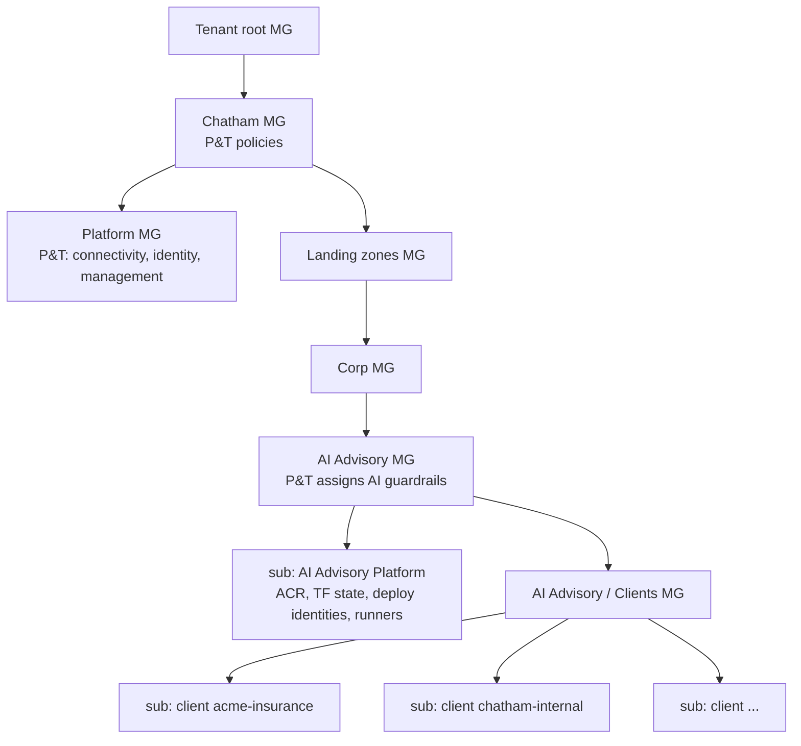
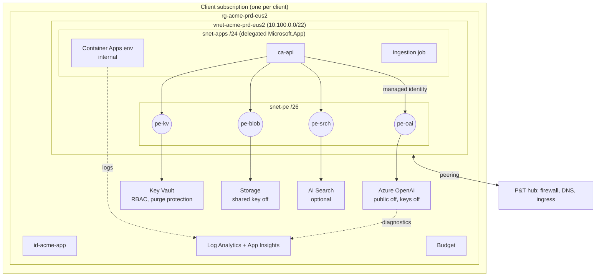
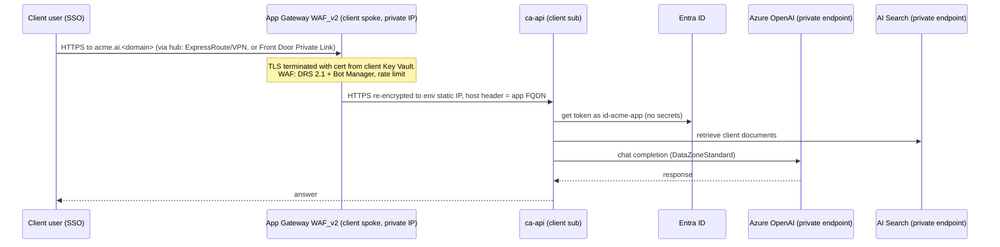
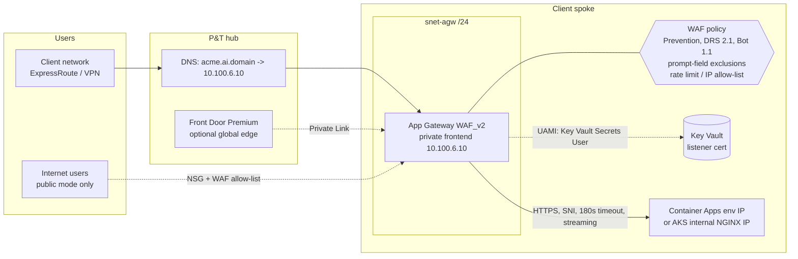
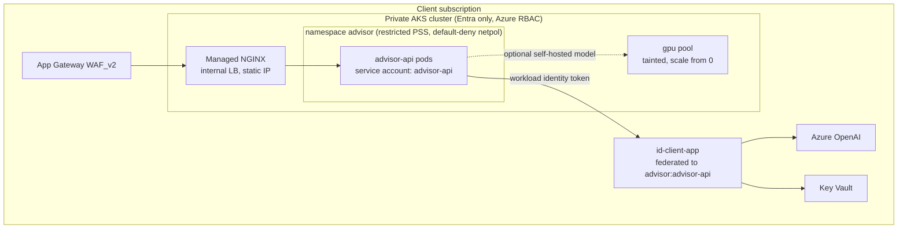
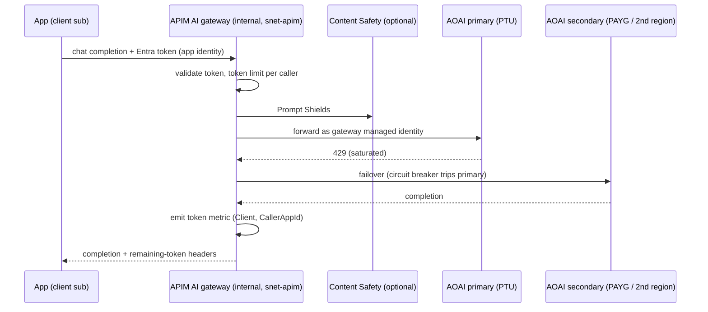

# Architecture overview

The full multi-client diagram, with every component for three example clients, is
[diagram/solution-architecture.svg](diagram/solution-architecture.svg) (PNG:
[solution-architecture.png](diagram/solution-architecture.png)). The sections below break it down
piece by piece.

To change it, edit [diagram/generate.py](diagram/generate.py) and regenerate:

```bash
python3 docs/architecture/diagram/generate.py
NODE_PATH=$(npm root -g) node docs/architecture/diagram/render-png.mjs   # PNG, needs Playwright
```

## 1. Where this sits in Chatham's Azure estate



P&T owns every management group, policy assignment, and the connectivity subscription. AI Advisory
owns what's inside the platform subscription and the client subscriptions.

## 2. One client stamp



## 3. Request path (Container Apps)



## 4. Ingress (ADR 0010)



## 5. AKS variant of the stamp (ADR 0011)



Nodes use Azure CNI Overlay with Cilium. Egress goes through the hub firewall (UDR). P&T's Azure
Policy runs inside the cluster through the Azure Policy add-on, and Flux deploys `kubernetes/`.

## 6. AI gateway (ADR 0012)



With the gateway on, the app has no role on the model accounts, so every call goes through it.

## 7. What makes it multi-client without being shared
| Layer | Shared across clients? | Why |
|---|---|---|
| Terraform modules and stamp | Yes (code) | Build once |
| Container images | Yes (same digest promoted by ring) | Build once |
| ACR, TF state storage, CI runners | Yes, platform sub, **no client data** | Cost, simplicity |
| Subscription, VNet, AOAI, KV, Storage, Search, logs | **No** | Isolation (ADR 0001) |
| App Gateway, WAF policy, TLS certificate | **No** | Per-client edge, logs and blast radius (ADR 0010) |
| AKS cluster (when used) | **No** | Dedicated cluster per client (ADR 0011) |
| AI gateway (APIM) | **No** by default | Per client in the stamp; a shared APIM only for internal apps or with per-client workspace gateways (ADR 0012) |
| Deployment identity, GitHub Environment | **No** | Pipeline blast radius (ADR 0008) |
