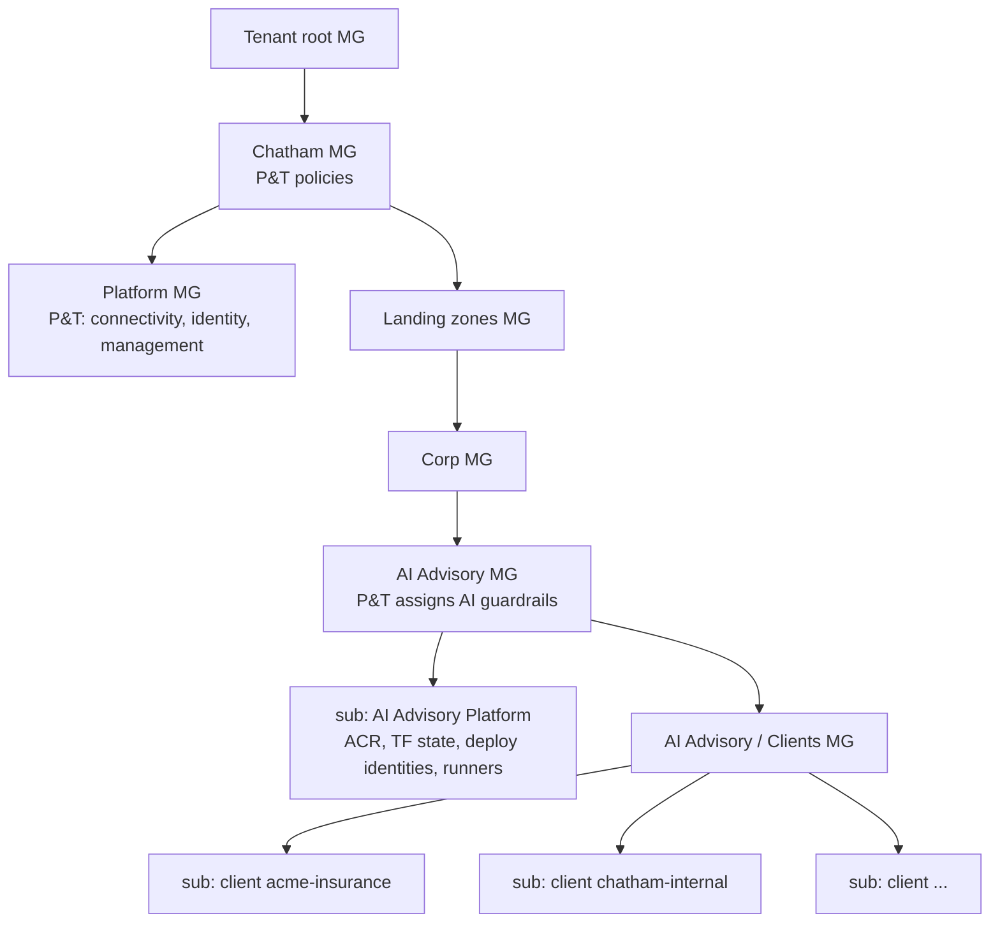
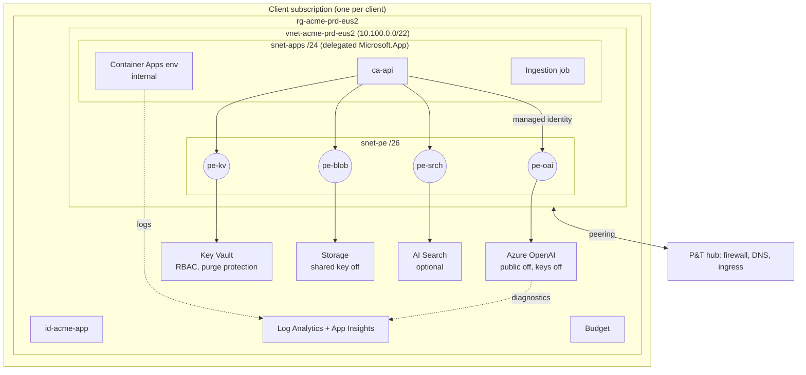
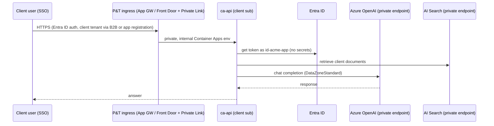

# Architecture overview

## 1. Where this sits in Chatham's Azure estate

P&T owns every management group, policy assignment, and the connectivity subscription. AI Advisory
owns what's inside the platform subscription and the client subscriptions.

## 2. One client stamp

## 3. Request path

## 4. What makes it multi-client without being shared
| Layer | Shared across clients? | Why |
|---|---|---|
| Terraform modules and stamp | Yes (code) | Build once |
| Container images | Yes (same digest promoted by ring) | Build once |
| ACR, TF state storage, CI runners | Yes, platform sub, **no client data** | Cost, simplicity |
| Subscription, VNet, AOAI, KV, Storage, Search, logs | **No** | Isolation (ADR 0001) |
| Deployment identity, GitHub Environment | **No** | Pipeline blast radius (ADR 0008) |
