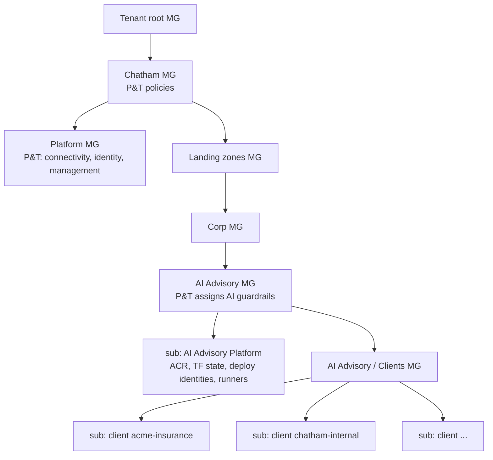
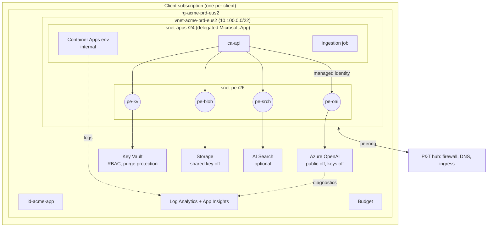
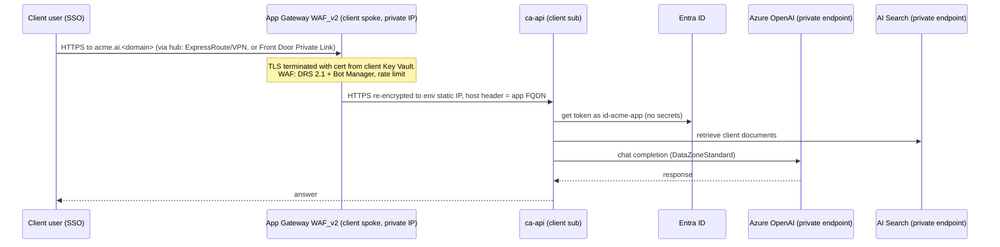
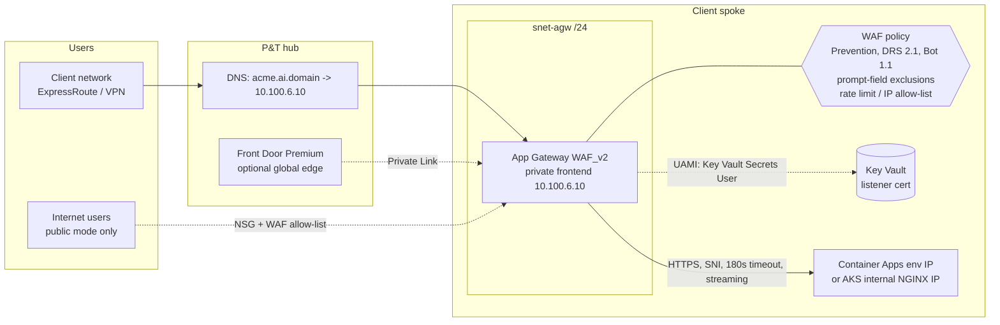
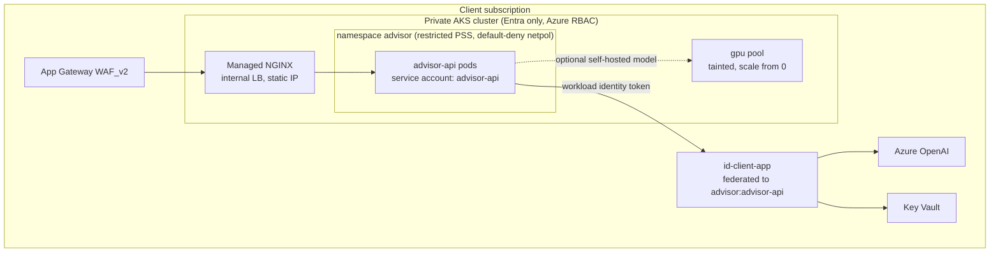
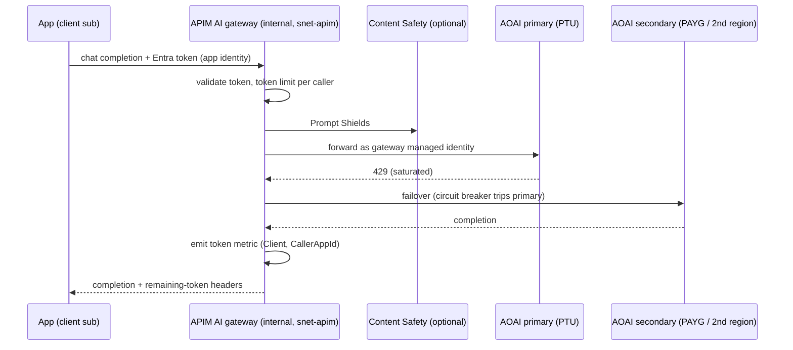
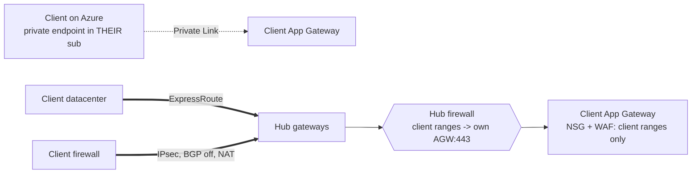

# Architecture overview

This page describes Tier 1, the dedicated subscription-per-client stamp. The two cheaper tiers (a
shared cell and a pooled app) are in [isolation-tiers.md](isolation-tiers.md), with their own diagrams
([tier2-shared-cell.svg](diagram/tier2-shared-cell.svg), [tier3-pooled.svg](diagram/tier3-pooled.svg)).
All three tiers' diagrams are next to each other in [tiers-side-by-side.md](tiers-side-by-side.md).

The full multi-client diagram, with every component for three example clients, is
[diagram/solution-architecture.svg](diagram/solution-architecture.svg) (PNG:
[solution-architecture.png](diagram/solution-architecture.png); editable draw.io versions below).
The sections below break it down
piece by piece.

### Editing in draw.io (diagrams.net)

The same diagram is published in two draw.io formats, with Azure icons and every box, label and arrow
as its own editable shape:

| File | Use |
|---|---|
| [diagram/solution-architecture.drawio](diagram/solution-architecture.drawio) | Native file for app.diagrams.net, draw.io desktop or the VS Code "Draw.io Integration" extension |
| [diagram/solution-architecture.drawio.svg](diagram/solution-architecture.drawio.svg) | An SVG that GitHub renders and draw.io opens as an editable diagram (the model is embedded) |

- [Open in diagrams.net](https://app.diagrams.net/#Uhttps%3A%2F%2Fraw.githubusercontent.com%2Fcoppercosmo%2Fchatham_fin_infra%2Fmain%2Fdocs%2Farchitecture%2Fdiagram%2Fsolution-architecture.drawio): opens a copy from `main`; use File > Save as to keep it (device, OneDrive, Google Drive...).
- [Open from GitHub in diagrams.net](https://app.diagrams.net/#Hcoppercosmo%2Fchatham_fin_infra%2Fmain%2Fdocs%2Farchitecture%2Fdiagram%2Fsolution-architecture.drawio): after authorising the diagrams.net GitHub app you can save straight back to the repo as a commit.

Pick one source of truth. `generate.py` overwrites all four files, so once someone edits the `.drawio`
by hand, either carry the change back into `generate.py` or stop regenerating and treat the `.drawio` as the
source (export the SVG/PNG from draw.io with File > Export).

### Regenerating from code

To change it in code, edit [diagram/generate.py](diagram/generate.py) and regenerate:

```bash
python3 docs/architecture/diagram/generate.py         # Tier 1 solution architecture
python3 docs/architecture/diagram/generate_tiers.py   # Tier 2 and Tier 3 diagrams
python3 docs/architecture/diagram/generate_ai_flow.py # AI request flow (RAG)
python3 docs/architecture/diagram/generate_side_by_side.py  # the three tiers in one image; run after the first two
NODE_PATH=$(npm root -g) node docs/architecture/diagram/render-png.mjs solution-architecture tier2-shared-cell tier3-pooled ai-request-flow tiers-side-by-side   # PNGs, needs Playwright
```

All three generators share the drawing helpers, palette and Azure icons in [diagram/drawlib.py](diagram/drawlib.py).

## 1. Where this sits in Chatham's Azure estate



P&T owns every management group, policy assignment, and the connectivity subscription. AI Advisory
owns what's inside the platform subscription and the client subscriptions.

## 2. One client stamp



## 3. Request path (Container Apps)

What the app does between receiving the question and answering it (embed, search the client's index,
generate through the AI gateway, and how the index gets filled) is drawn step by step in
[diagram/ai-request-flow.svg](diagram/ai-request-flow.svg) and explained in the
[AI layer deep dive](../interview/deep-dives/ai-architecture.md).



## 4. Ingress (ADR 0010)



## 5. AKS variant of the stamp (ADR 0011)



Nodes use Azure CNI Overlay with Cilium. Egress goes through the hub firewall (UDR). P&T's Azure
Policy runs inside the cluster through the Azure Policy add-on, and Flux deploys `kubernetes/`.

## 6. AI gateway (ADR 0012)



With the gateway on, the app has no role on the model accounts, so every call goes through it.

## 7. What makes it multi-client without being shared
| Layer | Shared across clients? | Why |
|---|---|---|
| Terraform modules and stamp | Yes (code) | Build once |
| Container images | Yes (same digest promoted by ring) | Build once |
| ACR, TF state storage, CI runners | Yes, platform sub, **no client data** | Cost, simplicity |
| Subscription, VNet, AOAI, KV, Storage, Search, logs | **No** | Isolation (ADR 0001) |
| App Gateway, WAF policy, TLS certificate | **No** | Per-client edge, logs and blast radius (ADR 0010) |
| AKS cluster (when used) | **No** | Dedicated cluster per client (ADR 0011) |
| AI gateway (APIM) | **No** by default | Per client in the stamp; a shared APIM only for internal apps or with per-client workspace gateways (ADR 0012) |
| Deployment identity, GitHub Environment | **No** | Pipeline blast radius (ADR 0008) |
| Hub ExpressRoute / VPN gateways, firewall, DNS resolver | **Yes**, P&T-owned | Shared plumbing, but one connection, route, firewall rule and DNS zone per client, no BGP between clients, overlap refused in CI. Private Link clients don't touch it (ADR 0013) |

## 8. Client network connectivity (ADR 0013)



`client_connectivity` per client: `privatelink` (preferred), `expressroute`, `vpn` or `none`. The
stamp emits `hub_connectivity_request` for P&T's `hub-connectivity` module. Full design, isolation
controls, onboarding order and a plain-words networking glossary:
[client-connectivity.md](client-connectivity.md).
