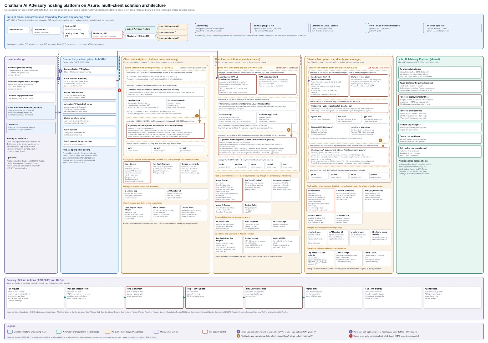
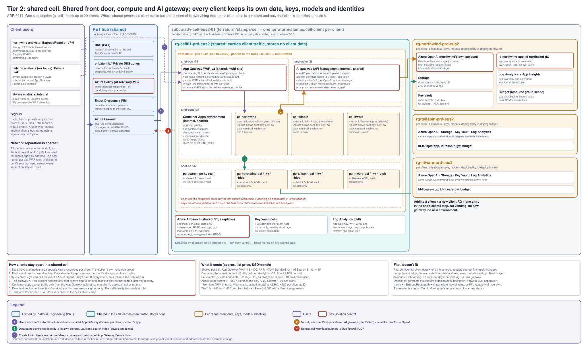
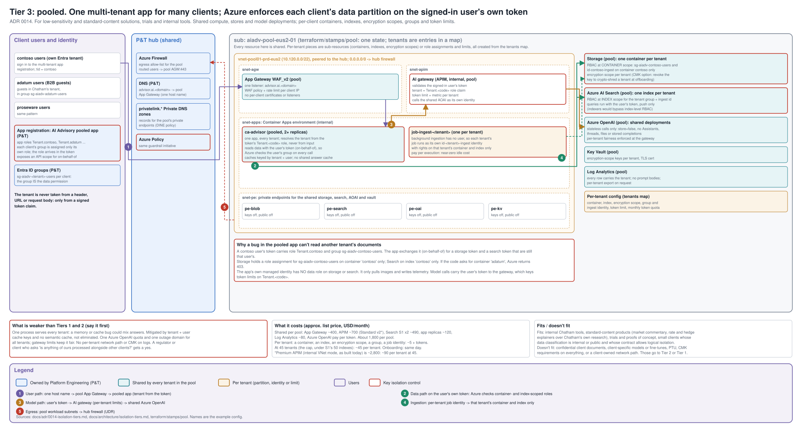

# The three isolation tiers, side by side

All three tier diagrams on one page, from most isolated (left) to cheapest (right). Click a diagram to
open it full size. The design, the cost math and the interview answers are in
[isolation-tiers.md](isolation-tiers.md), and the decision is
[ADR 0014](../adr/0014-isolation-tiers.md) (proposed).

**The pattern in one sentence:** each tier shares more of the expensive parts that hold no data (front
door, AI gateway, compute, search units) and keeps the cheap parts that hold data (storage, vault,
index, model account, logs) per client, so the fixed cost drops from about 1,500 to 170 to 45 USD a
month per client, and the boundary between clients moves from a subscription, to a resource group with
roles only for that client's identities, to the signed-in user's own token.

<table>
<tr>
<th width="33%">Tier 1: Dedicated (default)</th>
<th width="33%">Tier 2: Shared cell</th>
<th width="33%">Tier 3: Pooled</th>
</tr>
<tr>
<td valign="top" align="center">

 <a href="diagram/solution-architecture.svg">SVG</a> · <a href="diagram/solution-architecture.png">PNG</a> · <a href="diagram/solution-architecture.drawio">draw.io</a>
</td>
<td valign="top" align="center">

 <a href="diagram/tier2-shared-cell.svg">SVG</a> · <a href="diagram/tier2-shared-cell.png">PNG</a> · <a href="diagram/tier2-shared-cell.drawio">draw.io</a>
</td>
<td valign="top" align="center">

 <a href="diagram/tier3-pooled.svg">SVG</a> · <a href="diagram/tier3-pooled.png">PNG</a> · <a href="diagram/tier3-pooled.drawio">draw.io</a>
</td>
</tr>
<tr>
<td valign="top">
<em>A private copy of everything, in the client's own subscription.</em>
<ul>
<li><b>Fixed cost:</b> ~USD 1,500 per client a month (~3,600 with Premium API Management).</li>
<li><b>Shared:</b> only Platform Engineering's hub.</li>
<li><b>Kept apart by:</b> a separate subscription, so a separate network, front door, AI gateway, compute, data, keys, model and logs.</li>
<li><b>Data allowed:</b> up to highly confidential.</li>
<li><b>Trade-off:</b> the most expensive, and onboarding takes days to weeks while P&amp;T vends a subscription.</li>
<li><b>Blast radius:</b> 1 client.</li>
<li><b>Terraform:</b> <a href="../../terraform/stamps/client"><code>stamps/client</code></a></li>
</ul>
</td>
<td valign="top">
<em>Shared building, separate locked rooms: up to 20 clients in one cell subscription.</em>
<ul>
<li><b>Fixed cost:</b> ~1,650 per cell + ~90 per client = <b>~USD 170 per client</b> at 20.</li>
<li><b>Shared:</b> network, App Gateway, Container Apps environment, API Management, search service. They carry client traffic but store no client data.</li>
<li><b>Per client, in its own resource group:</b> storage, Key Vault, search index, Azure OpenAI account, logs, identities, budget.</li>
<li><b>Kept apart by:</b> Azure roles. Keys are off everywhere, only the client's own identities have roles on its data, and its gateway API calls its model as that client's identity.</li>
<li><b>Data allowed:</b> up to confidential.</li>
<li><b>Trade-off:</b> coarser network separation (shared VNet, front-door IP and endpoint subnet) and shared Microsoft-managed compute.</li>
<li><b>Blast radius:</b> up to 20 clients. Onboarding takes hours (three pull requests).</li>
<li><b>Terraform:</b> <a href="../../terraform/stamps/cell"><code>stamps/cell</code></a> + <a href="../../terraform/stamps/cell-client"><code>stamps/cell-client</code></a></li>
</ul>
</td>
<td valign="top">
<em>One app for up to 45 tenants; Azure checks the signed-in user's own token on every data call.</em>
<ul>
<li><b>Fixed cost:</b> ~1,800 per pool + ~5 per tenant = <b>~USD 45 per tenant</b> at 45.</li>
<li><b>Shared:</b> one app, one model account, one storage account and one search service.</li>
<li><b>Per tenant:</b> blob container and encryption scope, search index, Entra group, ingestion identity, token limit.</li>
<li><b>Kept apart by:</b> the user's own token. The app has no data role; it reads on behalf of the user, and Azure checks the user's tenant group on the container and the index.</li>
<li><b>Data allowed:</b> public and internal only (Terraform refuses more).</li>
<li><b>Trade-off:</b> one process serves every tenant, so a memory or cache bug could mix answers; one model quota and one outage for everyone.</li>
<li><b>Blast radius:</b> up to 45 tenants. Onboarding is same day.</li>
<li><b>Terraform:</b> <a href="../../terraform/stamps/pool"><code>stamps/pool</code></a></li>
</ul>
</td>
</tr>
</table>

Costs are approximate US list prices with Standard v2 API Management, to show the shape of the saving.
Azure OpenAI tokens are left out because they cost the same per token in every tier. Check the Azure
pricing calculator before quoting them.

## One image for screen sharing

[diagram/tiers-side-by-side.png](diagram/tiers-side-by-side.png) puts the three diagrams in one wide
picture, at the same width, with each tier's cost, data allowed, blast radius and boundary above it.
Open it and zoom in, or share it full screen when you walk through the trade-off.
SVG: [diagram/tiers-side-by-side.svg](diagram/tiers-side-by-side.svg).

## Related

- [Which client gets which tier](isolation-tiers.md#which-client-gets-which-tier): the decision flow,
  and [what 200 clients cost](isolation-tiers.md#what-200-clients-cost) as a mix of tiers.
- [AI request flow](diagram/ai-request-flow.svg): one question from the analyst to a cited answer.
  The steps are the same in every tier; which identity makes each call changes, as explained in
  [isolation of the AI layer, tier by tier](../interview/deep-dives/ai-architecture.md#isolation-of-the-ai-layer-tier-by-tier).
- To change a diagram, edit its generator and rebuild this page's image afterwards
  ([how](overview.md#regenerating-from-code)).
