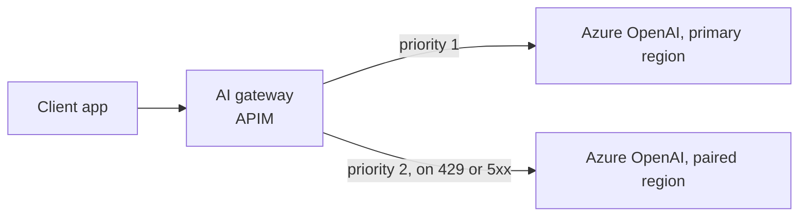

# Disaster recovery and model capacity

How a client environment survives a regional outage, and how to plan Azure OpenAI capacity so clients
don't hit throttling. Related: [ADR 0006](../../adr/0006-azure-openai-per-client.md),
[ADR 0012](../../adr/0012-ai-gateway-api-management.md) (AI gateway),
[runbook: AOAI throttling](../../runbooks/incident-aoai-throttling.md).

## Plain words first

- **RTO** (recovery time objective): how long the client can be without the service.
- **RPO** (recovery point objective): how much recent data they can afford to lose.
- **Region pair:** two Azure regions Microsoft treats as partners (for example East US 2 and Central
  US). Some services replicate to the pair automatically.
- **TPM:** tokens per minute, the unit of Azure OpenAI quota and rate limits.
- **PTU:** provisioned throughput units, capacity you reserve and pay for whether you use it or not.

## Targets per tier (proposed, to agree with each client)

| | Tier 1 | Tier 2 | Tier 3 |
|---|---|---|---|
| Model calls | Fail over to the secondary region within minutes through the AI gateway | Same, per client backend | Same, pool backend |
| Whole environment | Warm standby stamp in the paired region; RTO ~4 h, RPO ~15 min | Rebuild the cell and client groups in the paired region from Terraform; RTO ~24 h, RPO ~1 h | Rebuild the pool; RTO ~24 h, RPO ~24 h |
| Cost of DR | A second stamp, scaled to zero where possible | Cheap: storage replication plus Terraform | Cheapest |

The point: DR is a per-tier, per-client choice with a price, not one answer for everyone.

## What each component needs

| Component | What happens in an outage | What we do |
|---|---|---|
| Azure OpenAI | The account is regional | A second account (or deployment) in the paired region behind the AI gateway |
| Storage (documents, history) | Regional, unless geo-replicated | Geo-zone-redundant storage (GZRS) for Tier 1 and 2; failover is customer-initiated |
| AI Search index | No built-in cross-region replication | Re-index from storage in the secondary region, or keep a second index fed by the same ingestion job (Tier 1) |
| Key Vault | Contents replicated within the geography by Microsoft; read-only during a failover | Nothing to build, but write operations wait |
| Container Apps, App Gateway, APIM | Regional | Deployed by the same stamp with `location` set to the secondary region |
| Log Analytics | Regional | A workspace per region; logs aren't failed over |
| Private DNS and the hub | P&T's | P&T's DR plan; we hand them the secondary IPs as Terraform outputs |

Because every environment is a Terraform stamp with `location` as an input, "rebuild in the other
region" is a pipeline run, not a project. The data is the part that needs a plan.

## Failing over model calls through the AI gateway

The AI gateway already sits between the app and the model, so it is the natural place for model
failover, and the app doesn't change:

- APIM **backend pools** with priority: send everything to the primary; when its **circuit breaker**
  trips (the AI gateway module already configures one on 429 and 5xx, honouring `Retry-After`), send
  traffic to the secondary. The circuit breaker is built; the pool itself isn't yet, because azurerm
  4.81 doesn't expose pool backends (an `azapi` resource or a newer provider; listed in the README's
  known gaps).
- Both backends must be in the same data zone (for example two US regions), so failover doesn't break
  data residency.
- The secondary needs quota approved in advance. Quota requests take time, so they are part of
  onboarding, not the incident.
- Premium APIM can also run gateways in more than one region; Developer and Standard v2 can't, so
  for those the gateway itself is redeployed by Terraform in a regional outage.

## Capacity: pay-as-you-go versus provisioned (PTU)

| | Pay-as-you-go (`Standard`, `DataZoneStandard`) | Provisioned (`ProvisionedManaged`, `DataZoneProvisionedManaged`) |
|---|---|---|
| Pay for | Tokens used | Reserved PTUs, per hour or with a monthly or yearly reservation |
| Limit | TPM quota per subscription, region and model; HTTP 429 when exceeded | The PTUs you bought; 429 when full |
| Latency | Varies with Azure-wide load | Predictable |
| Good for | Most clients, spiky or low volume | Steady high volume, latency-sensitive production |
| Tier | All tiers | Tier 1 only (enforced in `cell-client` validation) |

**Spillover:** a PTU deployment can send overflow to a pay-as-you-go deployment of the same model in
the same account (`spilloverDeploymentName`, or per request with the `x-ms-spillover-deployment`
header). Spilled requests are billed at pay-as-you-go rates and show in metrics with `IsSpillover`. For
anything more complex (different accounts or regions), the AI gateway's backend pool does the same job.

## Planning capacity

1. **Estimate peak TPM:** peak requests per minute x (prompt tokens + retrieved chunks + completion
   tokens). RAG prompts are big: 10 retrieved chunks of 500 tokens is 5,000 tokens before the question.
2. **Add headroom** (about 30%) and check it against the subscription's regional quota for that model
   and deployment type.
3. **Per-client limits at the gateway** (`llm-token-limit`) so one client's batch job can't use the
   whole allocation. In Tier 1 the quota is the client's own; in Tier 2 each client's deployment
   capacity is its own but comes out of the cell's regional quota; in Tier 3 the gateway limit per
   tenant is the only thing keeping it fair.
4. **Watch 429s and utilisation** per client (see the observability deep dive). Sustained high use on
   pay-as-you-go is the signal to price PTU for that client.
5. **Run ingestion off-peak** (Container Apps jobs on a schedule) so embeddings don't compete with chat.

## Interview questions and answers

**"A region goes down. What happens to client X?"**
Model calls fail over through the AI gateway to the paired region within minutes, because the backend
pool has a second account with pre-approved quota. If the whole region is out, we run the same
Terraform stamp with the secondary region; documents come from geo-replicated storage, and the search
index is rebuilt from them. Tier 1 clients who pay for it have a warm standby instead.

**"How do you stop one client's batch job from throttling everyone?"**
In Tiers 1 and 2 each client has its own model deployments, so their capacity is theirs. On top of that
the gateway enforces a tokens-per-minute limit per client, and ingestion runs off-peak. In the pooled
tier the per-tenant gateway limit is the main control.

**"When would you buy PTU?"**
When a client has steady, high volume or needs predictable latency, and the utilisation data shows
pay-as-you-go would cost about the same or they're seeing 429s. I'd keep spillover to pay-as-you-go so
peaks don't fail. PTU is a Tier 1 feature because the reservation belongs to one client.

**"What's hard about DR for RAG specifically?"**
The search index. Storage replicates, but AI Search doesn't, so you either rebuild the index from
storage after failover (slower, cheaper) or keep a second index in sync (faster, double the cost).
Embeddings also cost tokens to regenerate, which is worth knowing for large corpora.
