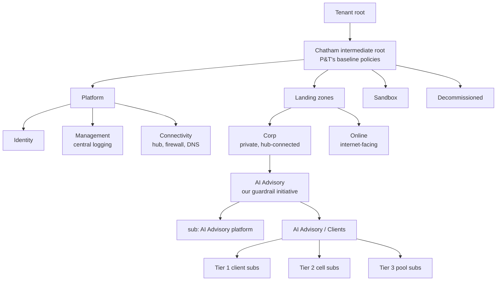

# Landing zones, subscription vending and Azure Policy

How Chatham's central Platform Engineering team (P&T) likely organises Azure, how a new client
subscription gets created, and how Azure Policy enforces the rules. Related:
[ADR 0002](../../adr/0002-work-inside-platform-engineering-guardrails.md),
[architecture overview, section 1](../../architecture/overview.md),
[policy/README.md](../../../policy/README.md) and `terraform/modules/policy-guardrails`. Which compliance
standards Defender for Cloud would score on top of these rules, and how the rules map to their controls:
[compliance-standards.md](../../architecture/compliance-standards.md).

## Plain words first

- **Management group (MG):** a folder for subscriptions. Policies and role assignments set on a folder
  apply to everything inside it, including subscriptions added later.
- **Landing zone:** a subscription that arrives already wired up: in the right MG, peered to the hub
  network, with logging, security tooling and policies in place. You "land" your workload in it.
- **Azure Landing Zones (ALZ):** Microsoft's reference design for the MG tree and the policies that
  go with it. Most enterprises, very likely including Chatham, use it or something close.
- **Subscription vending:** creating landing-zone subscriptions automatically from a request (a form
  or a pull request), so every one is identical and nobody clicks through the portal.
- **Azure Policy:** rules Azure checks when a resource is created or changed (and periodically for
  existing ones). A rule can block, report, or fix.

## The ALZ management group tree, and where AI Advisory sits

AI Advisory sits under **Corp** because everything is private and reached through the hub. Policies
are inherited downwards: P&T's baseline at the top, Corp's "no public IPs" style rules, then our
AI-specific initiative at the AI Advisory MG.

## Subscription vending (and resource group vending in Tier 2)

What a vending request typically does, in order (Microsoft publishes this as the Azure Verified Module
"subscription vending" pattern):

1. Creates the subscription under the right billing account (a subscription alias).
2. Moves it into the target MG, so policies apply from minute one.
3. Creates the spoke VNet with an address range from IPAM and peers it to the hub.
4. Assigns roles: our deployment identity, P&T-owned Entra groups for readers and operators.
5. Sets a budget and tags (cost centre, owner).

For us that is the slow part of Tier 1 onboarding (days to weeks of elapsed time), which is one reason
the cheaper tiers exist. In **Tier 2** a cell is vended once; after that, the cell does "resource group
vending" for each client itself (`client_slots` in `stamps/cell`): a resource group with the required
tags, and narrow rights for that client's own pipeline identity. Same idea, smaller scope.

## Policy effects you should be able to explain

| Effect | What it does | Example in this repo |
|---|---|---|
| `Deny` | Blocks the create or update | Storage, Key Vault, AI Search or AI services with public network access; resource groups without required tags |
| `Audit` | Allows it, marks it non-compliant | Any `Deny` rule during rollout (via the `effect` parameter) |
| `Modify` | Adds or changes properties (usually tags) on create, and remediates existing resources | Copy `client`, `cost_center` and so on from the resource group to resources missing them |
| `DeployIfNotExists` (DINE) | After a resource is created, deploys a related resource if it's missing | Register a new private endpoint in P&T's central `privatelink.*` DNS zone |
| `AuditIfNotExists` | Reports when a related resource is missing | Diagnostic settings missing (P&T's baseline usually has these) |
| `DenyAction` | Blocks a specific action, such as delete | Protect a resource from deletion without a lock |

`Modify` and `DINE` need the **assignment's managed identity** to have roles (for example Contributor
for tags, Network Contributor on the DNS zones). Existing resources are only fixed by a **remediation
task**; new ones are handled on create.

## The rules proposed here, and why each one exists

| Rule | Effect | Why it matters for multi-client AI |
|---|---|---|
| AI services: keys disabled | Deny | A key can't be scoped to one client's identity; a token can |
| AI services: public network off | Deny | Prompts stay on private networking |
| Storage, Key Vault, AI Search: public network off | Deny | Same for documents, chunks and secrets |
| Allowed model deployment SKUs | Deny | Blocks `GlobalStandard` so prompts stay in the data zone |
| Required resource group tags | Deny | Cost showback and data handling need `client`, `cost_center`, `data_classification`, `owner` |
| Inherit tags from the resource group | Modify | Tags set once on the group reach every resource |
| Private endpoint DNS registration | DINE | Stamps never write to P&T's DNS zones; the policy does |
| Allowed locations (built-in) | Deny | Data residency; both DR regions allowed |

All of them are in one **initiative** (a policy set), so P&T assigns one thing at the AI Advisory MG.

## Rolling out a policy without breaking anyone

1. Assign with `enforcementMode = DoNotEnforce` (`enforce = false` in the module). Everything is
   evaluated and reported; nothing is blocked or deployed.
2. Read the compliance report. Fix what's wrong, or create an **exemption**: `Waiver` (accepted risk)
   or `Mitigated` (handled another way). The module requires an expiry date and an ADR reference.
3. Switch to enforce. Run remediation tasks for `Modify` and `DINE` rules on existing resources.
4. Keep the initiative in Terraform, versioned, and change it through pull requests like any code.

## Working inside P&T's guardrails

P&T owns management groups, policy assignments, Entra groups, the hub and DNS (ADR 0002). We don't
fight that; we make it easy for them to say yes:
- Our stamps already follow every rule we propose, so assigning it costs us nothing.
- Requests to P&T are outputs of our Terraform (`hub_connectivity_request`, DNS records, firewall
  rules), not free-text tickets.
- Where Tier 2 needs something new (two narrow custom roles at a cell's resource group), it is written
  down as an open question in ADR 0014 for P&T to decide.

## Interview questions and answers

**"Walk me through how a new client gets a subscription."**
We raise a vending request with the client name, CIDR from IPAM, cost centre and owner. P&T's
vending automation creates the subscription, puts it in the AI Advisory Clients MG so policies apply
immediately, peers the spoke to the hub, assigns our deployment identity and their Entra groups, and
sets a budget. Then our pipeline applies the client stamp with the client's own identity.

**"What's the difference between Deny and DeployIfNotExists?"**
Deny stops a bad resource being created. DINE lets the resource be created, then deploys something
missing next to it, using the assignment's managed identity. We use DINE for private endpoint DNS
records, so stamps never need write access to P&T's DNS zones.

**"How would you introduce a new Deny policy across 200 subscriptions safely?"**
Assign it in DoNotEnforce, read the compliance report, fix or exempt with an expiry date and a reason,
then enforce. Same pipeline and rings as code changes.

**"Why do Modify and DINE policies need an identity?"**
Because Azure makes the change on your behalf after the fact. The assignment's managed identity needs
the roles the definition declares, and remediation tasks use it to fix existing resources.

**"A team needs an exception. How do you handle it?"**
A policy exemption scoped as narrowly as possible, with a category, an expiry date and a written
reason (an ADR). No permanent exemptions; an expired one shows up as non-compliant again.
